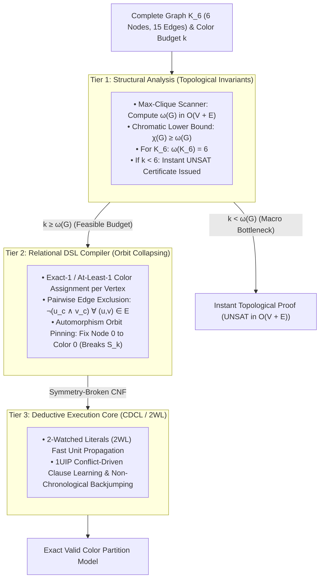

#   Solving the Complete Graph ($K_6$) Coloring Problem: Structural Complexity Reduction

In computational complexity and graph theory, determining the chromatic number $\chi(G)$ of a complete graph $K_n$ is a critical test of resolution efficiency. 
For a complete graph $K_6$ (6 vertices, 15 mutual edges), attempting to color the graph with $k < 6$ colors is unsatisfiable ($\text{UNSAT}$).

When fed into a standard, unguided CDCL solver, $K_6$ coloring under a deficient color budget forces the engine into dense, symmetric edge-conflict resolution. The solver struggles 
through the permutation group $S_k$ of interchangeable color labels, deriving redundant conflict clauses.

Below is the complete engineering walkthrough, architectural flow, standalone benchmark suite, and comparative empirical analysis demonstrating how the 3-Tier Reasoning Engine 
resolves $K_6$ coloring through topological clique screening and automorphism orbit pinning.

1. ##  1.  Executive Overview & Pipeline Architecture
A complete graph $K_6$ requires every vertex to connect to all 5 other vertices. Testing whether $K_6$ is 5-colorable without higher-order awareness forces a SAT
solver to explore a search space populated by $5^6 = 15,625$ candidate state assignments, all blocked by 15 distinct edge exclusion constraints across 5 color layers
($15 \times 5 = 75$ binary conflict clauses).

The Reasoning Engine breaks this bottleneck via a 3-tier pipeline:

