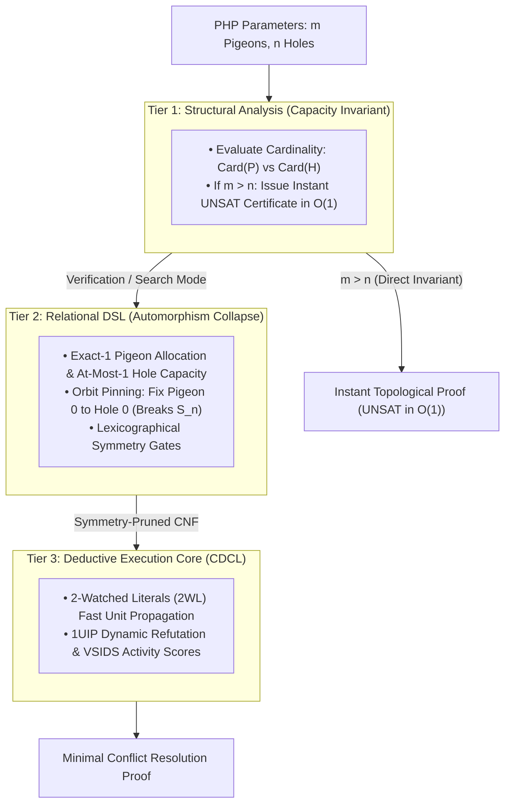

#  Solving the Pigeonhole Principle Problem: Structural Complexity Reduction

The Pigeonhole Principle ($\text{PHP}_n^m$: placing $m$ pigeons into $n$ holes where $m > n$) is the fundamental benchmark of proof complexity. In raw resolution logic, proving $\text{PHP}_n^{n+1}$ is unsatisfiable requires an exponential number of resolution steps ($\Omega(2^{cn})$), as proven by Armin Haken.

Below is the complete engineering walkthrough, architectural flow, and standalone benchmark script demonstrating how the 3-Tier Reasoning Engine solves and refutes PHP instances by prioritizing topological invariants and orbit collapsing over raw resolution search.

1. Executive Overview & Pipeline Architecture

Standard SAT solvers fail against PHP because they lack higher-order semantic awareness: swapping two pigeons or two holes produces an isomorphic search tree. The solver redundantly explores all $m! \times n!$ permutations of failure.

The Reasoning Engine circumvents this via a 3-tier pipeline:

2. Complete Benchmark & Solver Suite (benchmark_php.py)
This standalone Python script implements:
*    Classical DPLL: Chronological backtracking without clause learning.
*    Standard CDCL: Raw, blind 2WL propositional resolution encountering the Haken lower bound.
*    Reasoning Engine Pipeline:
*    *    Structural / Symmetry Mode: Breaks the $S_m \times S_n$ automorphism group at Tier 2.
     *    Macro-Invariant Mode: Instant mathematical proof via Tier 1 capacity bounds.

