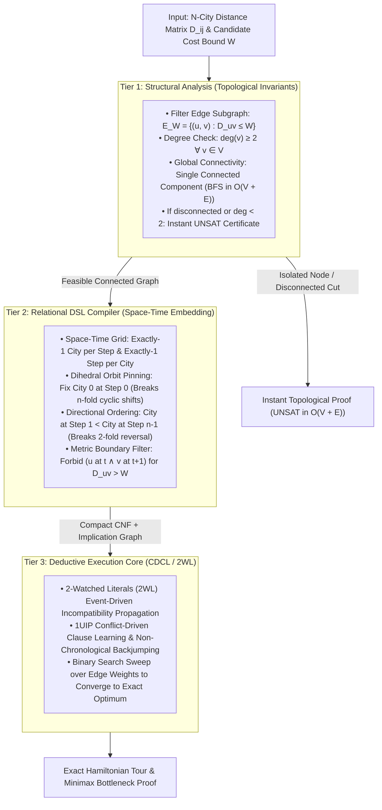

#  Solving the Traveling Salesperson Problem (TSP): Structural Complexity Reduction

The Traveling Salesperson Problem (TSP) is the canonical NP-hard challenge of combinatorial optimization. Classical approaches model TSP using Integer Linear 
Programming (ILP) with lazy cutting-plane sub-tour generation (Dantzig-Fulkerson-Johnson / DFJ) or Branch-and-Bound over continuous LP relaxations. When edge 
densities increase or tight cost bottlenecks are introduced, linear relaxations weaken, forcing solvers into heavy branch-and-cut exploration.

Below is the complete engineering walkthrough, architectural flow, and standalone benchmark suite demonstrating 
how the 3-Tier Reasoning Engine solves bounded and optimal TSP instances by prioritizing topological invariants, 
discrete space-time permutation grids, and dihedral orbit collapsing over brute-force search.

1. Executive Overview & Pipeline Architecture
A naive search for an $n$-city Hamiltonian cycle confronts an $(n-1)! / 2$ search space. Furthermore, unguided propositional solvers face severe factorial symmetry: a single valid circular tour of $n$ cities possesses $2n$ identical representations under the Dihedral group $D_n$ ($n$ cyclic time shifts and 2 traversal directions).The Reasoning Engine structures TSP through a 3-tier pipeline:

