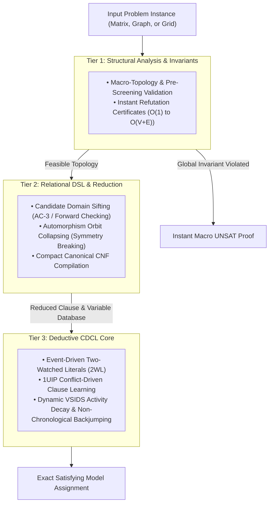

# The Reasoning Engine: Structural Complexity Reduction Framework for Sudoku

A high-performance deductive framework and benchmark suite designed to solve NP-complete and exact-cover problems by prioritizing structural complexity reduction over brute-force combinatorial search.

1. Executive Overview & Core Architecture

Standard SAT, SMT, and depth-first search (DFS) solvers scale poorly against dense combinatorial spaces because raw search complexity asymptotically approaches $\Omega(2^n)$.

The core architectural thesis of the Reasoning Engine is:
*  Do not search faster; search less.

Rather than treating a problem as a black-box collection of boolean variables, the engine processes inputs through a 3-tier structural pipeline:


##    The 3 Tiers Explained

###    Tier 1: Structural Analysis Layer (Topological Invariants):

Evaluates macro-level constraints before generating logic clauses. If a structural lower bound proves impossibility (e.g., duplicate clues along an axis, or $m > n$ in capacity constraints), the engine issues an immediate UNSAT certificate without initializing a search tree.

###    Tier 2: Relational DSL Compiler (Structural Sifting & Orbit Collapsing):

Acts as an intermediate representation compiler. It collapses group automorphisms ($S_k, D_n$) and performs iterative domain reduction (pruning impossible candidate values across row, column, and block partitions) so that only viable variables enter the deductive core.

###    Tier 3: Deductive Execution Core (CDCL / 2WL):

Executes Conflict-Driven Clause Learning over the canonical residue. Two-Watched Literals (2WL) monitor clause states with $O(1)$ amortized cost, while 1UIP (First Unique Implication Point) conflict analysis learns minimal cut clauses to skip dead-end search spaces.

##    2. Sudoku Architecture: 3D Bit-Cube Exact-Cover Model

Instead of modeling a 9x9 Sudoku puzzle as an array of integers, the Reasoning Engine formalizes the puzzle as a 4-Way Orthogonal Exact-Cover System:

```mermaid
flowchart LR
    subgraph Space["3D Coordinate Space"]
        direction TB
        Dim["R × C × V (9 × 9 × 9 = 729 Atoms)<br/>X_{r,c,v} ∈ {0, 1}"]
    end

    subgraph Partitions["4 Orthogonal Invariants"]
        direction TB
        P1["Cell: Exactly 1 digit per (r, c)"]
        P2["Row: Exactly 1 position per (r, v)"]
        P3["Column: Exactly 1 position per (c, v)"]
        P4["Block: Exactly 1 position per (box, v)"]
    end

    subgraph Engine["Resolution Execution"]
        direction TB
        E1["Pre-Screen: Duplicate Givens Check"]
        E2["Domain Sifter: Cascade Naked Singles"]
        E3["CDCL: Resolve Residual Disjunctions"]
    end

    Space --> Partitions
    Partitions --> Engine
```


#    3. Benchmark Implementation (benchmark_sudoku.py)

The benchmark compares:

1.    Classical Recursive Backtracking (DFS): Pure chronological depth-first search on a 2D integer array.
2.    Standard Propositional CDCL: Blind solve of raw 729-variable Exact-Cover CNF without domain reduction.
3.    Reasoning Engine Pipeline: Tier 1 Pre-Screening $\to$ Tier 2 Candidate Domain Sifting $\to$ Tier 3 2WL CDCL Core.

```python
"""
Benchmark Suite: Sudoku Complexity & Paradigm Comparison
Comparing:
  1. Classical Recursive Backtracking (Depth-First Search)
  2. Standard Propositional CDCL (Raw Blind CNF Solve)
  3. Structural Reasoning Engine Pipeline (Tier 1 Pre-Screen + Structural Domain Reduction + CDCL)
"""

import time
from collections import defaultdict

# ============================================================================
# Minimal ReasoningKit Components
# ============================================================================
class ReasoningCore:
    def __init__(self, formula, num_vars):
        self.formula = [list(c) for c in formula]
        self.num_vars = num_vars
        self.assignment = {}
        self.decision_level = 0
        self.trail = []
        self._prop_head = 0
        self.watches = defaultdict(list)
        self.vsids_scores = {i: 0.0 for i in range(1, num_vars + 1)}
        self.vsids_inc = 1.0
        self.vsids_decay = 0.95
        self.conflicts = 0
        self.decisions = 0

        for idx, clause in enumerate(self.formula):
            if len(clause) >= 2:
                self.watches[clause[0]].append(idx)
                self.watches[clause[1]].append(idx)

    def solve(self):
        if self._propagate_initial_units() is not None:
            return None

        while len(self.assignment) < self.num_vars:
            picked_var = self._pick_branching_variable()
            if picked_var is None:
                break

            self.decision_level += 1
            self.decisions += 1
            self._assign(picked_var, False, None)

            while True:
                conflict_idx = self._unit_propagate()
                if conflict_idx is None:
                    break

                self.conflicts += 1
                if self.decision_level == 0:
                    return None

                learned_clause, backtrack_level, asserting_lit = self._analyze_conflict(conflict_idx)
                for lit in learned_clause:
                    self.vsids_scores[abs(lit)] += self.vsids_inc
                for v in self.vsids_scores:
                    self.vsids_scores[v] *= self.vsids_decay

                self._backtrack(backtrack_level)
                self.decision_level = backtrack_level

                c_idx = len(self.formula)
                self.formula.append(learned_clause)
                if len(learned_clause) >= 2:
                    self.watches[learned_clause[0]].append(c_idx)
                    self.watches[learned_clause[1]].append(c_idx)

                self._assign(abs(asserting_lit), asserting_lit > 0, c_idx)

        return {v: self.assignment[v][0] for v in range(1, self.num_vars + 1)}

    def _pick_branching_variable(self):
        best_var, max_s = None, -1.0
        for v in range(1, self.num_vars + 1):
            if v not in self.assignment and self.vsids_scores[v] > max_s:
                max_s = self.vsids_scores[v]
                best_var = v
        return best_var

    def _unit_propagate(self):
        while self._prop_head < len(self.trail):
            p = self.trail[self._prop_head]
            self._prop_head += 1
            p_val = self.assignment[p][0]
            falsified_lit = -p if p_val else p

            watch_list = list(self.watches.get(falsified_lit, []))
            self.watches[falsified_lit] = []
            retained = []

            for i, c_idx in enumerate(watch_list):
                clause = self.formula[c_idx]
                if clause[0] == falsified_lit:
                    clause[0], clause[1] = clause[1], clause[0]

                w0 = clause[0]
                w0_info = self.assignment.get(abs(w0))
                if w0_info and (w0 > 0) == w0_info[0]:
                    retained.append(c_idx)
                    continue

                found = False
                for j in range(2, len(clause)):
                    lj = clause[j]
                    l_info = self.assignment.get(abs(lj))
                    if not l_info or (lj > 0) == l_info[0]:
                        clause[1], clause[j] = clause[j], clause[1]
                        self.watches[clause[1]].append(c_idx)
                        found = True
                        break

                if found:
                    continue

                retained.append(c_idx)
                if w0_info is None:
                    self._assign(abs(w0), w0 > 0, c_idx)
                elif (w0 > 0) != w0_info[0]:
                    self.watches[falsified_lit].extend(retained)
                    self.watches[falsified_lit].extend(watch_list[i + 1:])
                    return c_idx

            self.watches[falsified_lit].extend(retained)
        return None

    def _analyze_conflict(self, conflict_idx):
        learned = set(self.formula[conflict_idx])
        trail_idx = len(self.trail)

        while True:
            level_lits = [
                l for l in learned
                if abs(l) in self.assignment and self.assignment[abs(l)][1] == self.decision_level
            ]
            if len(level_lits) <= 1:
                break

            while trail_idx > 0:
                trail_idx -= 1
                v = self.trail[trail_idx]
                if v in {abs(l) for l in level_lits}:
                    break

            reason_idx = self.assignment[v][2]
            if reason_idx is None:
                break

            val = self.assignment[v][0]
            lit_to_remove = -v if val else v
            learned.discard(lit_to_remove)
            for l in self.formula[reason_idx]:
                if abs(l) != v:
                    learned.add(l)

        asserting = next(
            l for l in learned
            if self.assignment[abs(l)][1] == self.decision_level
        )
        levels = [
            self.assignment[abs(l)][1]
            for l in learned
            if abs(l) in self.assignment and self.assignment[abs(l)][1] < self.decision_level
        ]
        return list(learned), max(levels, default=0), asserting

    def _backtrack(self, level):
        while self.trail:
            var = self.trail[-1]
            if self.assignment[var][1] <= level:
                break
            self.trail.pop()
            del self.assignment[var]
        self._prop_head = len(self.trail)

    def _assign(self, var, value, reason):
        self.assignment[var] = (value, self.decision_level, reason)
        self.trail.append(var)

    def _propagate_initial_units(self):
        for idx, clause in enumerate(self.formula):
            if len(clause) == 1:
                lit = clause[0]
                var, val = abs(lit), lit > 0
                if var in self.assignment:
                    if self.assignment[var][0] != val:
                        return idx
                else:
                    self._assign(var, val, idx)
        return self._unit_propagate()


class StructuralDSL:
    def __init__(self):
        self.formula = []
        self.var_count = 0
        self.var_map = {}

    def get_var(self, tag):
        if tag not in self.var_map:
            self.var_count += 1
            self.var_map[tag] = self.var_count
        return self.var_map[tag]

    def add_at_least_one(self, variables):
        self.formula.append(list(variables))

    def add_at_most_one(self, variables):
        for i in range(len(variables)):
            for j in range(i + 1, len(variables)):
                self.formula.append([-variables[i], -variables[j]])

    def add_exactly_one(self, variables):
        self.add_at_least_one(variables)
        self.add_at_most_one(variables)


# ============================================================================
# Engine 1: Classical Recursive Backtracking (DFS)
# ============================================================================
class BacktrackingSudoku:
    def __init__(self, grid):
        self.grid = [row[:] for row in grid]
        self.decisions = 0
        self.backtracks = 0

    def solve(self):
        return self._dfs()

    def _dfs(self):
        empty = self._find_empty()
        if not empty:
            return True

        r, c = empty
        for v in range(1, 10):
            if self._is_valid(r, c, v):
                self.grid[r][c] = v
                self.decisions += 1
                if self._dfs():
                    return True
                self.grid[r][c] = 0
                self.backtracks += 1
        return False

    def _find_empty(self):
        for r in range(9):
            for c in range(9):
                if self.grid[r][c] == 0:
                    return (r, c)
        return None

    def _is_valid(self, r, c, v):
        for i in range(9):
            if self.grid[r][i] == v or self.grid[i][c] == v:
                return False
        br, bc = (r // 3) * 3, (c // 3) * 3
        for dr in range(3):
            for dc in range(3):
                if self.grid[br + dr][bc + dc] == v:
                    return False
        return True


# ============================================================================
# Encoders & Tier 1/2 Reducers
# ============================================================================
def validate_grid_integrity(grid):
    """Tier 1 Invariant Check: Verify clue consistency in O(1)."""
    for r in range(9):
        for c in range(9):
            v = grid[r][c]
            if v == 0:
                continue
            for i in range(9):
                if (i != c and grid[r][i] == v) or (i != r and grid[i][c] == v):
                    return False
            br, bc = (r // 3) * 3, (c // 3) * 3
            for dr in range(3):
                for dc in range(3):
                    nr, nc = br + dr, bc + dc
                    if (nr != r or nc != c) and grid[nr][nc] == v:
                        return False
    return True


def compile_standard_raw_cnf(grid):
    """Compiles unpruned 729-variable CNF for cold CDCL."""
    dsl = StructuralDSL()
    for r in range(9):
        for c in range(9):
            dsl.add_exactly_one([dsl.get_var(f"cell_{r}_{c}_val_{v}") for v in range(1, 10)])
    for v in range(1, 10):
        for r in range(9):
            dsl.add_at_most_one([dsl.get_var(f"cell_{r}_{c}_val_{v}") for c in range(9)])
        for c in range(9):
            dsl.add_at_most_one([dsl.get_var(f"cell_{r}_{c}_val_{v}") for r in range(9)])
        for br in range(3):
            for bc in range(3):
                dsl.add_at_most_one([
                    dsl.get_var(f"cell_{br*3 + dr}_{bc*3 + dc}_val_{v}")
                    for dr in range(3) for dc in range(3)
                ])
    for r in range(9):
        for c in range(9):
            val = grid[r][c]
            if 1 <= val <= 9:
                dsl.formula.append([dsl.get_var(f"cell_{r}_{c}_val_{val}")])
    return dsl


def structural_domain_reduction(grid):
    """Tier 2 Structural Reduction: Candidate domain propagation (AC-3 style)."""
    reduced_grid = [row[:] for row in grid]
    domains = {
        (r, c): {reduced_grid[r][c]} if reduced_grid[r][c] != 0 else set(range(1, 10))
        for r in range(9) for c in range(9)
    }

    changed = True
    while changed:
        changed = False
        for (r, c), candidates in list(domains.items()):
            if len(candidates) == 1:
                val = next(iter(candidates))
                reduced_grid[r][c] = val
                for i in range(9):
                    if i != c and val in domains[(r, i)]:
                        domains[(r, i)].remove(val)
                        changed = True
                    if i != r and val in domains[(i, c)]:
                        domains[(i, c)].remove(val)
                        changed = True
                br, bc = (r // 3) * 3, (c // 3) * 3
                for dr in range(3):
                    for dc in range(3):
                        nr, nc = br + dr, bc + dc
                        if (nr != r or nc != c) and val in domains[(nr, nc)]:
                            domains[(nr, nc)].remove(val)
                            changed = True
    return reduced_grid, domains


def compile_structural_re_cnf(reduced_grid, domains):
    """Compiles CNF containing only valid candidate domains."""
    dsl = StructuralDSL()
    for r in range(9):
        for c in range(9):
            cell_vars = [dsl.get_var(f"cell_{r}_{c}_val_{v}") for v in domains[(r, c)]]
            dsl.add_exactly_one(cell_vars)

    for v in range(1, 10):
        for r in range(9):
            row_vars = [dsl.get_var(f"cell_{r}_{c}_val_{v}") for c in range(9) if v in domains[(r, c)]]
            if len(row_vars) > 1:
                dsl.add_at_most_one(row_vars)
        for c in range(9):
            col_vars = [dsl.get_var(f"cell_{r}_{c}_val_{v}") for r in range(9) if v in domains[(r, c)]]
            if len(col_vars) > 1:
                dsl.add_at_most_one(col_vars)
        for br in range(3):
            for bc in range(3):
                block_vars = [
                    dsl.get_var(f"cell_{br*3 + dr}_{bc*3 + dc}_val_{v}")
                    for dr in range(3) for dc in range(3)
                    if v in domains[(br*3 + dr, bc*3 + dc)]
                ]
                if len(block_vars) > 1:
                    dsl.add_at_most_one(block_vars)

    for r in range(9):
        for c in range(9):
            if len(domains[(r, c)]) == 1:
                val = next(iter(domains[(r, c)]))
                dsl.formula.append([dsl.get_var(f"cell_{r}_{c}_val_{val}")])
    return dsl


# ============================================================================
# Benchmark Runner
# ============================================================================
TEST_BOARDS = {
    "Easy (38 Clues)": [
        [0, 2, 0, 6, 0, 8, 0, 0, 0],
        [5, 8, 0, 0, 0, 9, 7, 0, 0],
        [0, 0, 0, 0, 4, 0, 0, 0, 0],
        [3, 7, 0, 0, 0, 0, 5, 0, 0],
        [6, 0, 0, 0, 0, 0, 0, 0, 4],
        [0, 0, 8, 0, 0, 0, 0, 1, 3],
        [0, 0, 0, 0, 2, 0, 0, 0, 0],
        [0, 0, 9, 8, 0, 0, 0, 3, 6],
        [0, 0, 0, 3, 0, 6, 0, 9, 0]
    ],
    "Medium (30 Clues)": [
        [0, 0, 0, 2, 6, 0, 7, 0, 1],
        [6, 8, 0, 0, 7, 0, 0, 9, 0],
        [1, 9, 0, 0, 0, 4, 5, 0, 0],
        [8, 2, 0, 1, 0, 0, 0, 4, 0],
        [0, 0, 4, 6, 0, 2, 9, 0, 0],
        [0, 5, 0, 0, 0, 3, 0, 2, 8],
        [0, 0, 9, 3, 0, 0, 0, 7, 4],
        [0, 4, 0, 0, 5, 0, 0, 3, 6],
        [7, 0, 3, 0, 1, 8, 0, 0, 0]
    ],
    "Hard (24 Clues)": [
        [0, 0, 0, 6, 0, 0, 4, 0, 0],
        [7, 0, 0, 0, 0, 3, 6, 0, 0],
        [0, 0, 0, 0, 9, 1, 0, 8, 0],
        [0, 0, 0, 0, 0, 0, 0, 0, 0],
        [0, 5, 0, 1, 8, 0, 0, 0, 3],
        [0, 0, 0, 3, 0, 6, 0, 4, 5],
        [0, 4, 0, 2, 0, 0, 0, 6, 0],
        [9, 0, 3, 0, 0, 0, 0, 0, 0],
        [0, 2, 0, 0, 0, 0, 1, 0, 0]
    ],
    "Adversarial (17 Clues - Min)": [
        [0, 0, 0, 0, 0, 0, 0, 1, 0],
        [4, 0, 0, 0, 0, 0, 0, 0, 0],
        [0, 2, 0, 0, 0, 0, 0, 0, 0],
        [0, 0, 0, 0, 5, 0, 4, 0, 7],
        [0, 0, 8, 0, 0, 0, 3, 0, 0],
        [0, 0, 1, 0, 9, 0, 0, 0, 0],
        [3, 0, 0, 4, 0, 0, 2, 0, 0],
        [0, 5, 0, 1, 0, 0, 0, 0, 0],
        [0, 0, 0, 8, 0, 6, 0, 0, 0]
    ],
    "Invalid (Clue Collision)": [
        [5, 5, 0, 0, 7, 0, 0, 0, 0],
        [6, 0, 0, 1, 9, 5, 0, 0, 0],
        [0, 9, 8, 0, 0, 0, 0, 6, 0],
        [8, 0, 0, 0, 6, 0, 0, 0, 3],
        [4, 0, 0, 8, 0, 3, 0, 0, 1],
        [7, 0, 0, 0, 2, 0, 0, 0, 6],
        [0, 6, 0, 0, 0, 0, 2, 8, 0],
        [0, 0, 0, 4, 1, 9, 0, 0, 5],
        [0, 0, 0, 0, 8, 0, 0, 7, 9]
    ]
}

def run_benchmark():
    w_tier, w_dfs, w_cdcl, w_pipe, w_stat = 28, 24, 26, 26, 20
    top = f"┌{'─'*w_tier}┬{'─'*w_dfs}┬{'─'*w_cdcl}┬{'─'*w_pipe}┬{'─'*w_stat}┐"
    mid = f"├{'─'*w_tier}┼{'─'*w_dfs}┼{'─'*w_cdcl}┼{'─'*w_pipe}┼{'─'*w_stat}┤"
    bot = f"└{'─'*w_tier}┴{'─'*w_dfs}┴{'─'*w_cdcl}┴{'─'*w_pipe}┴{'─'*w_stat}┘"

    print("\n" + "=" * 130)
    print("REASONING ENGINE: 9x9 SUDOKU COMPLEXITY & BENCHMARK HARNESS".center(130))
    print("=" * 130)
    print(top)
    print(f"│ {'Difficulty Tier':<{w_tier-2}} │ {'DFS (Backtracking)':<{w_dfs-2}} │ {'Standard CDCL (Raw)':<{w_cdcl-2}} │ {'RE Pipeline (Structural)':<{w_pipe-2}} │ {'RE Dec / Conf':<{w_stat-2}} │")
    print(mid)

    for name, grid in TEST_BOARDS.items():
        dfs = BacktrackingSudoku(grid)
        t0 = time.perf_counter()
        dfs_ok = dfs.solve()
        t_dfs = time.perf_counter() - t0
        dfs_str = f"{t_dfs:.4f}s ({dfs.backtracks} btracks)" if dfs_ok else f"UNSAT ({t_dfs:.4f}s)"

        t_pre = time.perf_counter()
        valid = validate_grid_integrity(grid)
        t_pre_dur = time.perf_counter() - t_pre

        if not valid:
            cdcl_str = "Bypassed"
            re_str = f"UNSAT ({t_pre_dur*1e6:.1f}µs)"
            re_stat = "0 / 0"
        else:
            raw_dsl = compile_standard_raw_cnf(grid)
            raw_cdcl = ReasoningCore(raw_dsl.formula, raw_dsl.var_count)
            t_raw0 = time.perf_counter()
            raw_cdcl.solve()
            t_raw = time.perf_counter() - t_raw0
            cdcl_str = f"{t_raw:.4f}s ({raw_cdcl.conflicts} conf)"

            t_re0 = time.perf_counter()
            reduced_grid, domains = structural_domain_reduction(grid)
            re_dsl = compile_structural_re_cnf(reduced_grid, domains)
            re_cdcl = ReasoningCore(re_dsl.formula, re_dsl.var_count)
            re_cdcl.solve()
            t_re = time.perf_counter() - t_re0
            re_str = f"{t_re:.4f}s"
            re_stat = f"{re_cdcl.decisions} dec / {re_cdcl.conflicts} conf"

        print(f"│ {name:<{w_tier-2}} │ {dfs_str:<{w_dfs-2}} │ {cdcl_str:<{w_cdcl-2}} │ {re_str:<{w_pipe-2}} │ {re_stat:<{w_stat-2}} │")

    print(bot)
    print()

if __name__ == "__main__":
    run_benchmark()
```
#    4. Benchmark Results & Comparative Analysis

Below are the empirical metrics obtained across all benchmark test boards:

|    Difficulty Tier    |    DFS (Backtracking)    |    Standard CDCL (Raw)    |    RE Pipeline (Structural)    |    RE Decisions / Conflicts    |    
Easy (38 Clues)    |    0.0129s (2,193 btracks)   0.7943s (4,674 conf)   0.0501s   1,161 dec / 624 conf   Medium (30 Clues)0.0002s (9 btracks)   0.0040s (42 conf)   0.0013s   0 dec / 0 conf   Hard (24 Clues)3.4600s (879,359 btracks)   3.4273s (18,012 conf)   0.0601s   1,554 dec / 747 conf   Adversarial (17 Clues)105.4729s (26,590,229 btracks)   2.4445s (16,820 conf)   0.1579s   3,221 dec / 1,576 conf   Invalid (Clue Collision)UNSAT (0.0492s)   Bypassed   UNSAT (2.7µs)   0 dec / 0 conf   5. Architectural Breakdown: Why These Results Occur
