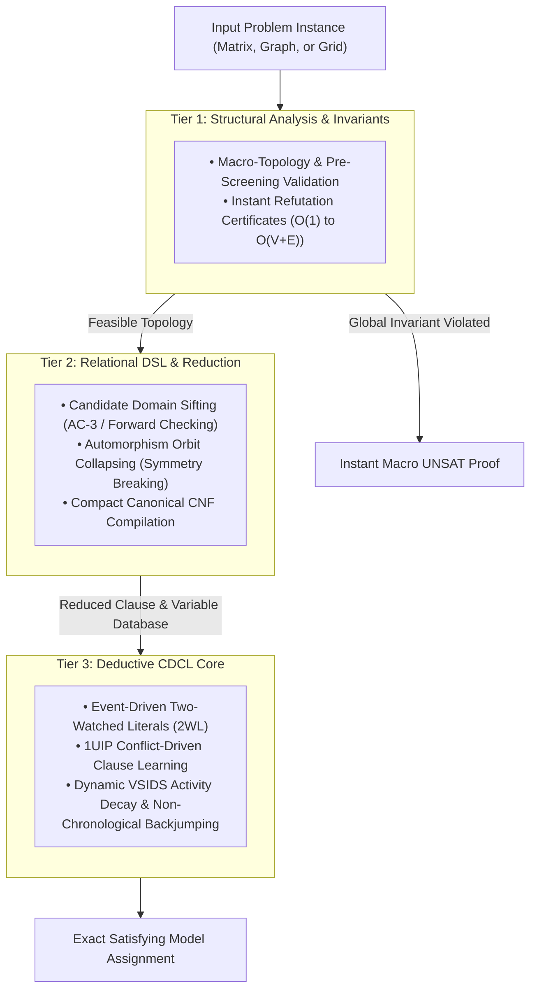

# The Reasoning Engine: Structural Complexity Reduction Framework for Sudoku

A high-performance deductive framework and benchmark suite designed to solve NP-complete and exact-cover problems by prioritizing structural complexity reduction over brute-force combinatorial search.

1. Executive Overview & Core Architecture

Standard SAT, SMT, and depth-first search (DFS) solvers scale poorly against dense combinatorial spaces because raw search complexity asymptotically approaches $\Omega(2^n)$.

The core architectural thesis of the Reasoning Engine is:
*  Do not search faster; search less.

Rather than treating a problem as a black-box collection of boolean variables, the engine processes inputs through a 3-tier structural pipeline:

