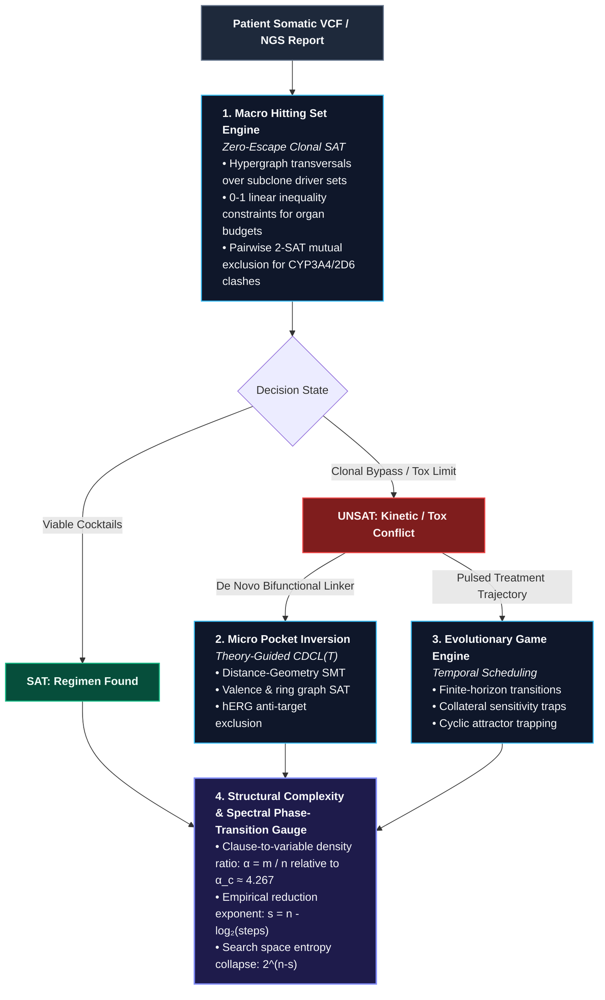

# Reasoning Engine: Structural Inversion & Complexity Reduction in Precision Oncology

An end-to-end discrete decision suite and domain-specific $\text{CDCL}(\mathcal{T})$ SMT framework implemented in native Rust. 

The **Reasoning Engine** reframes precision cancer therapeutics from an intractable heuristic search over $10^{60}$ chemical configurations into an **exact inverse constraint satisfaction problem**. Somatic sequencing profiles (NGS/VCF), subclonal evolutionary trajectories, multi-organ pharmacokinetic thresholds, and 3D receptor-ligand distance geometries are compiled into unified propositional and geometric theories solved deterministically without stochastic molecular dynamics or Monte Carlo scoring.

---

## 1. Theoretical Architecture & Computational Model

The system operates across three coupled computational layers:

### A. Macro Layer: Minimum-Weight Hypergraph Transversal
Given a tumor state partitioned into $K$ subclonal populations $\mathcal{S} = \{S_1, S_2, \dots, S_K\}$ derived from variant allele frequency (VAF) clustering, each subclone is defined by a set of essential driver alterations $D(S_k) \subset \mathcal{V}$. The formulary is a collection of therapeutic agents $\mathcal{D}$, where each drug $d \in \mathcal{D}$ inhibits a subset of targets $T(d) \subset \mathcal{V}$.

The macro engine solves the weighted hitting set problem under side constraints:
$$\text{Find } X \subseteq \mathcal{D} \quad \text{s.t.} \quad \forall S_k \in \mathcal{S}, \ \left( \bigcup_{d \in X} T(d) \right) \cap D(S_k) \neq \emptyset$$
subject to:
1. **Organ Toxicity Invariants (0-1 Knapsack Encodings):**
   $$\sum_{d \in X} w_d^{\text{organ}} \le W_{\max}^{\text{organ}} \quad \forall \text{organ} \in \{\text{hepatic}, \text{cardiac}, \text{renal}\}$$
2. **Pharmacokinetic Mutual Exclusion (2-SAT Horn Clauses):**
   $$\forall (d_i, d_j) \in \text{CYP\_Clashes}, \quad \neg x_{d_i} \lor \neg x_{d_j}$$

When multi-pathway bypasses and organ budgets prove this system strictly **UNSAT**, the engine branches into two formal resolution strategies: Micro Spatial Inversion or Temporal Evolutionary Scheduling.

### B. Micro Layer: Distance-Geometry $\text{CDCL}(\mathcal{T}_{\text{geom}})$ SMT Inversion
Instead of docking candidate scaffolds, the engine takes the target binding cleft coordinates $\mathcal{P} = \{p_1, \dots, p_M\} \subset \mathbb{R}^3$ and synthesizes a discrete ligand graph $G_L = (V_L, E_L)$ with element assignments $\tau: V_L \to \mathcal{E}$ via conflict-driven clause learning modulo theories ($\text{CDCL}(\mathcal{T})$):

* **Topological Valence Invariant ($\text{SAT}$):**
  $$\forall u \in V_L, \quad \sum_{v \in \mathcal{N}(u)} \text{order}(e_{uv}) \le \text{Valence}(\tau(u))$$
* **Spatial Reachability ($\mathcal{T}_{\text{geom}}$):**
  For anchor matches $m_{i, a}$ and $m_{j, b}$, all-pairs shortest path bounds $\text{dist}_{G_L}(i, j) \cdot [\ell_{\min}, \ell_{\max}]$ must satisfy the Euclidean interval $[\Vert{}\mathbf{x}_a - \mathbf{x}_b\Vert{} - \epsilon, \Vert{}\mathbf{x}_a - \mathbf{x}_b\Vert{} + \epsilon]$.
* **Theory Conflict Clause Propagation:**
  When a topological path cannot embed in $\mathbb{R}^3$ without steric clash or bond over-extension, $\mathcal{T}_{\text{geom}}$ projects a learned conflict back to the propositional core:
  $$C_{\text{conflict}} = \neg m_{i, a} \lor \neg m_{j, b} \lor \neg \text{Path}(i, j)$$
* **Anti-Target Invariant:** Enforces subgraph non-isomorphism against hERG cardiotoxic pharmacophore motifs.

### C. Temporal Layer: Evolutionary Steering & Collateral Sensitivity
Tumor evolution is modeled as an alternating game on a directed subclone state-transition graph over finite horizons $t \in \{1, \dots, T\}$. Rather than administering continuous multi-agent pressure that accelerates uniform resistance:
* **Selective Sweep / Steering Invariant:** Administering drug $d_A$ at cycle $t$ actively suppresses driver $k_1$ but directs secondary resistance toward a collateral sensitivity bottleneck $k_2$:
  $$x_{d_A, t} \implies \left( \neg v_{k_1, t} \land \text{Sensitized}(k_2, d_B, t+1) \right)$$
* **Attractor Trapping:** Enforces that no resistant subclone remains uninhibited for $> 2$ consecutive intervals, cycling selective pressure while guaranteeing complete clonal eradication ($\bigwedge_k \neg v_{k, T}$) within cumulative toxicity budgets.

---

## 2. Complexity Metrics & Phase-Transition Gauges

The suite instrumentally records problem structure $n$ and search reduction $s$, displaying live telemetry on the **Spectral Phase-Transition Gauge**:
