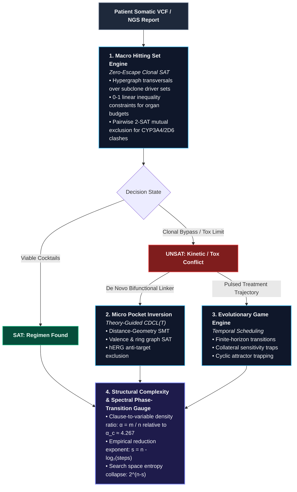

# Reasoning Engine: Structural Inversion & Complexity Reduction in Precision Oncology

An end-to-end discrete decision suite and domain-specific $\text{CDCL}(\mathcal{T})$ SMT framework implemented in native Rust. 

The **Reasoning Engine** reframes precision cancer therapeutics from an intractable heuristic search over $10^{60}$ chemical configurations into an **exact inverse constraint satisfaction problem**. Somatic sequencing profiles (NGS/VCF), subclonal evolutionary trajectories, multi-organ pharmacokinetic thresholds, and 3D receptor-ligand distance geometries are compiled into unified propositional and geometric theories solved deterministically without stochastic molecular dynamics or Monte Carlo scoring.

---

## 1. Theoretical Architecture & Computational Model

