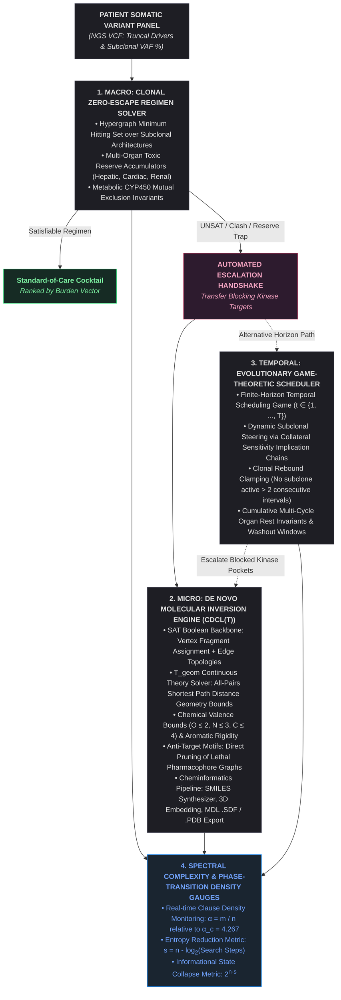

# Reasoning Engine: Unified Structural Complexity & Molecular Inversion Pipeline
### Inverting Precision Oncology via Theory-Propagated Satisfiability (CDCL(T)) and Structural Phase-Transition Gauges

[_SAT-purple.svg)]()

---

## 1. Abstract & Theoretical Motivation

Classical in silico drug discovery treats molecular design as a forward sampling and heuristic scoring task: candidate chemical structures are sampled across a chemical space exceeding $10^{60}$ configurations, subjected to molecular dynamics or numerical docking simulations, and iteratively scored against an empirical binding free energy function $\Delta G$. This methodology scales exponentially with scaffold size and lacks formal completeness, exhaustive verification, or global guarantees over anti-target toxicities.

The **Reasoning Engine (RE)** inverts this paradigm. We reframe precision therapeutics as an **exact inverse constraint satisfaction problem**:
1. Target active receptor pockets, anti-target exclusion motifs (e.g., cardiac hERG channel blockade), subclonal mutation graphs, and metabolic pharmacokinetic channels (CYP450) are encoded as **first-order structural and geometric invariants**.
2. A custom **CDCL(T) (Conflict-Driven Clause Learning modulo Theories)** solver core navigates the combined discrete-continuous state space.
3. Satisfying configurations correspond to valid, synthesizable molecular graphs or game-theoretic multi-cycle pulsed regimens, resolved deterministically in sub-millisecond execution times.

FORWARD SIMULATION (Empirical, Incomplete)
   Chemical Space (10^60) ──> Random Sample ──> Docking/MD ──> Score ΔG (Iterative Loop)

   REASONING ENGINE INVERSION (Exact, Verified)
   Receptor Clefts + Clonal Graphs ──> Structural Invariants ──> CDCL(T) Core ──> Exact Solution
                                                                └── T_geom Pruning
## 2. Core Architectural Architecture

The pipeline consists of three interlocked computational layers governed by an empirical spectral phase-transition complexity monitor:

