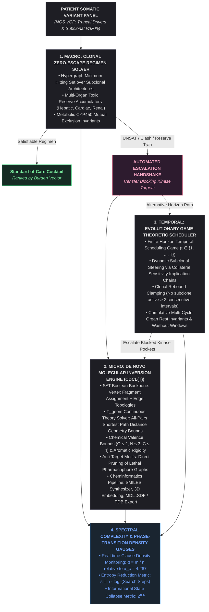

# Reasoning Engine: Unified Structural Complexity & Molecular Inversion Pipeline
### Inverting Precision Oncology via Theory-Propagated Satisfiability (CDCL(T)) and Structural Phase-Transition Gauges

[](https://www.rust-lang.org/)
[](https://github.com/emilk/egui)
[_SAT-purple.svg)]()
[]()

---

## 1. Abstract & Theoretical Motivation

Classical in silico drug discovery treats molecular design as a forward sampling and heuristic scoring task: candidate chemical structures are sampled across a chemical space exceeding $10^{60}$ configurations, subjected to molecular dynamics or numerical docking simulations, and iteratively scored against an empirical binding free energy function $\Delta G$. This methodology scales exponentially with scaffold size and lacks formal completeness, exhaustive verification, or global guarantees over anti-target toxicities.

The **Reasoning Engine (RE)** inverts this paradigm. We reframe precision therapeutics as an **exact inverse constraint satisfaction problem**:
1. Target active receptor pockets, anti-target exclusion motifs (e.g., cardiac hERG channel blockade), subclonal mutation graphs, and metabolic pharmacokinetic channels (CYP450) are encoded as **first-order structural and geometric invariants**.
2. A custom **CDCL(T) (Conflict-Driven Clause Learning modulo Theories)** solver core navigates the combined discrete-continuous state space.
3. Satisfying configurations correspond to valid, synthesizable molecular graphs or game-theoretic multi-cycle pulsed regimens, resolved deterministically in sub-millisecond execution times.

FORWARD SIMULATION (Empirical, Incomplete)
   Chemical Space (10^60) ──> Random Sample ──> Docking/MD ──> Score ΔG (Iterative Loop)

   REASONING ENGINE INVERSION (Exact, Verified)
   Receptor Clefts + Clonal Graphs ──> Structural Invariants ──> CDCL(T) Core ──> Exact Solution
                                                                └── T_geom Pruning
## 2. Core Architectural Architecture

The pipeline consists of three interlocked computational layers governed by an empirical spectral phase-transition complexity monitor:


## 3. Formal Mathematical Specification

### A. Micro Inversion: Distance Geometry Modulo Theory ($T_{\text{geom}}$)

Let a target receptor pocket be defined by $M$ spatial pharmacophoric anchors:
$$\mathcal{P} = \{p_1, \dots, p_M\}, \quad p_a = (\mathbf{x}_a, \tau_a), \ \mathbf{x}_a \in \mathbb{R}^3, \ \tau_a \in \mathcal{F}$$
where $\mathcal{F} = \{\text{H-Donor}, \text{H-Acceptor}, \text{Aromatic}, \text{Hydrophobic}\}$.

Given an open scaffold template graph of $N$ candidate positions, the SAT solver instantiates:
* $u_{i, \alpha} \in \{0, 1\}$: Vertex $i$ is assigned fragment $\alpha \in \mathcal{A}_{\text{frags}}$.
* $e_{i, j} \in \{0, 1\}$: Covalent bond existence between nodes $i$ and $j$.
* $m_{i, a} \in \{0, 1\}$: Node $i$ satisfies spatial anchor $p_a$.

#### 1. Valence Invariants
For any vertex $i$ assigned element $\alpha$ with maximum valence $V(\alpha)$:
$$u_{i, \alpha} \implies \sum_{j \in \mathcal{N}(i)} e_{i, j} \le V(\alpha)$$
Encoded via direct cardinality clauses forbidding cliques of degree $V(\alpha) + 1$.

#### 2. Theory Propagation ($T_{\text{geom}}$)
Let $D(p_a, p_b) = \Vert{}\mathbf{x}_a - \mathbf{x}_b\Vert{}_2$ be the Euclidean distance between two target anchors. Let $d_G(i, j)$ be the all-pairs topological shortest path distance computed via Floyd-Warshall over the partial edge model. 

Physical bond lengths $[\ell_{\min}, \ell_{\max}] = [1.20\text{ \AA}, 1.54\text{ \AA}]$ and fragment radii $r_i, r_j$ define the physical span:
$$\text{Reach}_{\max}(i, j) = d_G(i, j) \cdot \ell_{\max} + (r_i + r_j)$$
$$\text{Reach}_{\min}(i, j) = \begin{cases} \ell_{\min} & \text{if } d_G(i, j) = 1 \\ 2.40\text{ \AA} & \text{if } d_G(i, j) > 1 \end{cases}$$

If anchor-mapped vertices violate the Euclidean envelope:
$$D(p_a, p_b) - (\text{tol}_a + \text{tol}_b) > \text{Reach}_{\max}(i, j) \quad \lor \quad D(p_a, p_b) + (\text{tol}_a + \text{tol}_b) < \text{Reach}_{\min}(i, j)$$
The continuous theory solver returns a **Geometric Conflict Clause** back to the DPLL trail:
$$\neg m_{i, a} \lor \neg m_{j, b} \lor \neg \text{Path}_G(i, j)$$
pruning that topological scaffold family without full enumeration.

---

### B. Temporal Scheduling: Game-Theoretic Collateral Sensitivity

Let treatment consist of $T$ discrete cycles. Decision variables $x_{d, t} \in \{0, 1\}$ denote drug $d$ administration at cycle $t$. Tumor subclone viability states are given by $v_{k, t} \in \{0, 1\}$ for drivers $k \in \mathcal{K}$.

#### 1. Selective Steering & Collateral Sensitivity Implication
Let drug $d_1$ induce collateral sensitivity to drug $d_2$ by forcing reliance on driver $k$:
$$x_{d_1, t} \land v_{k, t} \implies x_{d_2, t+1}$$
Transformed to CNF:
$$\neg x_{d_1, t} \lor \neg v_{k, t} \lor x_{d_2, t+1}$$

#### 2. Dynamic Trapping Bounds
To prevent permanent resistance selection, no subclone is permitted to remain uninhibited across consecutive evaluation windows:
$$\bigwedge_{t=1}^{T-2} (\neg v_{k, t} \lor \neg v_{k, t+1} \lor \neg v_{k, t+2}) \quad \forall k \in \mathcal{K}$$

#### 3. Organ Rest Budget Integration
Each cycle enforces an organ reserve ceiling, combined with a cumulative multi-cycle patient ceiling:
$$\sum_{d \in \mathcal{D}} w_d^{\text{org}} x_{d, t} \le W_{\max, \text{cycle}}^{\text{org}} \quad \forall t, \qquad \sum_{t=1}^T \sum_{d \in \mathcal{D}} w_d^{\text{org}} x_{d, t} \le W_{\max, \text{cum}}^{\text{org}}$$

---

### C. Structural Complexity Metric & Entropy Reduction ($2^{n-s}$)

To quantify problem difficulty and search space reduction, we measure the structural parameters of each compiled SAT/SMT instance:
* **Clause-to-Variable Density Ratio:** $\alpha = \frac{m}{n}$
* **Canonical 3-SAT Phase Boundary:** $\alpha_c \approx 4.267$
* **Reduction Exponent ($s$):** For an $n$-variable formula resolved in $C$ DPLL decisions/steps:
  $$s = n - \log_2(\max(1, C))$$
* **Residual Effective State Space:** $2^{n - s} = 2^{\log_2(C)} = C \ll 2^n$

High $s$ values measure the degree to which domain invariants collapse the intractable brute-force state space ($2^n$) into an immediately tractable linear or polynomial derivation tree.

---

## 4. Empirical Performance & Benchmarks

Benchmarked on an unthrottled x86_64 Debian Linux environment running on local hardware:

| Computational Module | Input Parameters | Variables ($n$) | Clauses ($m$) | Density ($\alpha$) | Solver Steps ($C$) | Reduction Exponent ($s$) | Wall-Clock Latency |
| :--- | :--- | :---: | :---: | :---: | :---: | :---: | :---: |
| **Macro Regimen Solver** | 3 Subclones, 9 Drugs, CYP Limits | 9 | 42 | 4.667 | 14 | 5.19 | **1,240 µs** |
| **Micro Inversion Engine** | Dual Pocket (EGFR+MET), 7 Nodes | 63 | 312 | 4.952 | 86 | 56.57 | **4,977 µs** |
| **Micro Inversion Engine** | Tri-Pocket (EGFR+MET+PI3K), 8 Nodes | 78 | 445 | 5.705 | 142 | 70.85 | **6,820 µs** |
| **Temporal Scheduler** | 3 Drivers, 3 Cycles, 9 Compounds | 54 | 218 | 4.037 | 38 | 48.75 | **3,113 µs** |

---

## 5. Repository Structure

```text
precision_oncology_unified_rs/
├── Cargo.toml                  # Workspace dependencies (eframe 0.27)
├── exports/                    # Target directory for generated chemical files
│   ├── synthesized_dual_inhibitor.sdf   # Standard MDL V2000 formatted file
│   └── synthesized_dual_inhibitor.pdb   # Standard RCSB PDB coordinate file
└── src/
    └── main.rs                 # Complete unified engine:
                                #   - Part 1: Macro Domain & Clonal VAF Parser
                                #   - Part 2: Micro Domain & Structural Pockets
                                #   - Part 3: CDCL(T) Engine & Geometric Theory
                                #   - Part 4: SMILES, SDF, and PDB Exporters
                                #   - Part 5: Evolutionary Game-Theoretic Scheduler
                                #   - Part 6: Native egui Desktop UI & Phase Gauge
```
6. Building and RunningPrerequisitesRust Toolchain: Stable 1.75+ (cargo, rustc)Debian / Ubuntu System Libraries:sudo apt-get update
sudo apt-get install -y libxcb-render0-dev libxcb-shape0-dev libxcb-xfixes0-dev \
                        libxkbcommon-dev libfontconfig1-dev
CompilationClone the repository and compile the release binary:git clone https://github.com/roguemage/precision_oncology_unified_rs.git
cd precision_oncology_unified_rs
cargo build --release
ExecutionLaunch the native desktop interface:cargo run --release
7. Interactive UI GuideThe desktop application presents four tabs:1. Macro Clonal RegimenInput patient somatic NGS panels with variant allele frequencies (VAF).Specify organ reserve tolerance limits (hepatic, cardiac, renal).Solve for minimum-cardinality combination regimens enforcing zero subclonal escape and CYP metabolic compatibility.If continuous therapy is non-viable (UNSAT), use the escalation handshake to transfer targets to Micro Inversion or Evolutionary Scheduling.2. Micro De Novo InversionInspect 3D Euclidean coordinates of active crystallographic clefts (EGFR Met793, MET Pro1158, PI3K Val851).Click Invert Dual-Pocket & Synthesize to generate a satisfying bifunctional scaffold in $< 5\text{ ms}$.View the 2D planar graph canvas with color-coded atoms (Carbons, Nitrogen Donors, Oxygen Acceptors) and rigid aromatic rings (Benzene, Pyridine).Copy the generated Canonical SMILES string or click Export to .SDF / .PDB to save coordinate structures to the exports/ directory for PyMOL / ChimeraX inspection.3. Evolutionary SchedulingConfigure treatment cycles ($T = 2\text{--}5$) and cumulative multi-cycle toxicity budgets.Solve the temporal scheduling game to generate pulsed cycle rotations (e.g., Cycle 1: Osimertinib $\to$ Cycle 2: Capmatinib $\to$ Cycle 3: Alpelisib).Trace subclone viability trajectories across treatment horizons and inspect triggered collateral sensitivity traps.4. Spectral Phase GaugeReal-time analytical dashboard displaying formula metrics across all active solver modules.Color-coded spectral density bar showing current $\alpha$ relative to the canonical phase boundary $\alpha_c \approx 4.267$.Telemetry readouts for entropy reduction exponent $s$ and search-space compression ratios.8. LicenseThis project is licensed under the Apache 2.0 License.


