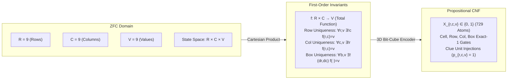

#  Designing a Universal Reasoning Engine: Implementation Guide for 9x9 Sudoku

This document formalizes the 9x9 Sudoku puzzle within the Structural Complexity Reduction framework. It bridges Zermelo-Fraenkel Set Theory with Choice (ZFC), the 3D Bit-Cube Boolean embedding, and our 3-tier Python implementation using ReasoningKit.

#  1. Theoretical Bridge: Grounding Sudoku in ZFC Set Theory
Sudoku is often treated as a standard array-backtracking challenge, but in formal computational logic it is an Exact-Cover / Latin-Square Extension Problem. We map the discrete coordinate system directly into first-order relational constraints over ZFC ordinals.

