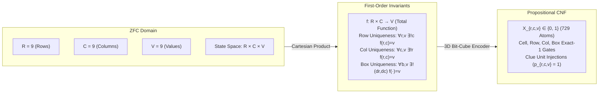
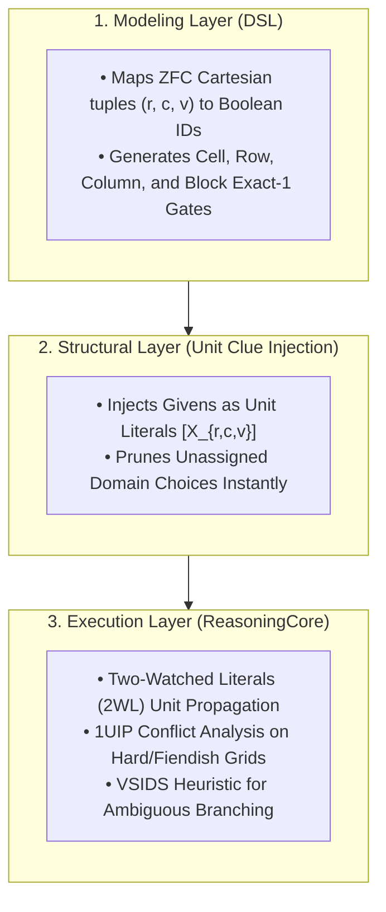

#  Designing a Universal Reasoning Engine: Implementation Guide for 9x9 Sudoku

This document formalizes the 9x9 Sudoku puzzle within the Structural Complexity Reduction framework. It bridges Zermelo-Fraenkel Set Theory with Choice (ZFC), the 3D Bit-Cube Boolean embedding, and our 3-tier Python implementation using ReasoningKit.

#  1. Theoretical Bridge: Grounding Sudoku in ZFC Set Theory
Sudoku is often treated as a standard array-backtracking challenge, but in formal computational logic it is an Exact-Cover / Latin-Square Extension Problem. We map the discrete coordinate system directly into first-order relational constraints over ZFC ordinals.


##    The Problem in ZFC Axiomatics

Let the set of row indices $R$, column indices $C$, and assigned digits $V$ each be isomorphic to the finite ordinal $9 = \{0, 1, \dots, 8\}$. For digits, we map $V = \{1, 2, \dots, 9\}$.

1.    The 3D Bit-Cube Product:
By the Axiom of Pairing and Axiom of Union, we construct the product space:

$$R \times C \times V = \{ (r, c, v) : r \in R \land c \in C \land v \in V \}$$

This yields a finite universe of $\vert{}R \times C \times V\vert{} = 9 \times 9 \times 9 = 729$ discrete propositional ground states.

2.    The Exact-1 Functional Invariants (4-Way Dual Orthogonality):

A completed grid is a functional assignment $f: R \times C \to V$. To satisfy the Latin square and block partitions, $f$ must obey four simultaneous Exact-1 ($\exists !$) cardinality constraints:

*    Cell Well-Definedness (Every cell holds exactly one digit):
$$\forall r \in R, \, \forall c \in C, \, \exists ! v \in V \text{ such that } f(r, c) = v$$

*    Row Latin Property (Every digit appears exactly once per row):

$$\forall r \in R, \, \forall v \in V, \, \exists ! c \in C \text{ such that } f(r, c) = v$$

*    Column Latin Property (Every digit appears exactly once per column):

$$\forall c \in C, \, \forall v \in V, \, \exists ! r \in R \text{ such that } f(r, c) = v$$

Block Partition Property (Every digit appears exactly once per $3 \times 3$ box):Partition $R \times C$ into 9 disjoint subsets $B_{b_r, b_c} = \{ (3b_r + dr, 3b_c + dc) : dr, dc \in \{0, 1, 2\} \}$ for $b_r, b_c \in \{0, 1, 2\}$.

$$\forall (b_r, b_c), \, \forall v \in V, \, \exists ! (dr, dc) \text{ such that } f(3b_r + dr, 3b_c + dc) = v$$

3.    Clue Injections as Axiomatic Truths (Unit Assertions):A puzzle clue $G \subset R \times C \times V$ is a fixed relation. Each predetermined entry $(r, c, v) \in G$ is injected as an immutable unit axiom:

$$\bigwedge_{(r, c, v) \in G} X_{r, c, v}$$

Because unit clues directly trigger Two-Watched Literals (2WL) chains, high-density propagation often cascades and solves large portions of the board without requiring search branches.

#    2. The 3-Tier Layer Cake Architecture



# 3. Step-by-Step ImplementationStep

##    1: Conceptual Objects and Canonical Mapping
Each coordinate $(r, c, v) \in R \times C \times V$ represents the statement: "Cell $(r, c)$ contains digit $v$." We import StructuralDSL directly from ReasoningKit to maintain this coordinate bijection:

```python
from ReasoningKit import StructuralDSL

dsl = StructuralDSL()

# ZFC Mapping: (r, c, v) -> Canonical Propositional Variable X_{r, c, v}
# Example: Map Row 0, Column 4 containing Value 7
r, c, v = 0, 4, 7
var_id = dsl.get_var("cell", r, c, "val", v)
```

##    Step 2: Enforcing Structural Invariants (Exact-1 Partitions)
We enforce the Latin-Square and cell properties using dsl.add_exactly_one(). Because each cell has an add_exactly_one constraint across values, enforcing add_at_most_one across rows, columns, and blocks mathematically completes the Exact-Cover formulation with minimal clause redundancy.

```python
def apply_sudoku_invariants(dsl: StructuralDSL) -> None:
    """
    Enforces the four Latin-Square Exact-1 partition invariants.
    1. Cell Uniqueness: Each (r, c) contains exactly one digit v.
    2. Row Uniqueness: Each digit v appears at most once per row r.
    3. Column Uniqueness: Each digit v appears at most once per column c.
    4. Block Uniqueness: Each digit v appears at most once per 3x3 block.
    """
    # 1. Cell Uniqueness (\forall r, c, \exists! v)
    for r in range(9):
        for c in range(9):
            cell_vars = [dsl.get_var("cell", r, c, "val", v) for v in range(1, 10)]
            dsl.add_exactly_one(cell_vars)

    # 2. Row, Column, and Block Constraints (\forall v \in 1..9)
    for v in range(1, 10):
        # Row Uniqueness
        for r in range(9):
            row_vars = [dsl.get_var("cell", r, c, "val", v) for c in range(9)]
            dsl.add_at_most_one(row_vars)

        # Column Uniqueness
        for c in range(9):
            col_vars = [dsl.get_var("cell", r, c, "val", v) for r in range(9)]
            dsl.add_at_most_one(col_vars)

        # 3x3 Block Uniqueness
        for br in range(3):
            for bc in range(3):
                block_vars = [
                    dsl.get_var("cell", br * 3 + dr, bc * 3 + dc, "val", v)
                    for dr in range(3)
                    for dc in range(3)
                ]
                dsl.add_at_most_one(block_vars)
```

##    Step 3: Injecting Clues as Fixed Facts

Each non-zero entry in the input grid is an axiomatic fact. By adding these entries directly into dsl.formula as single-literal clauses ([var_id]), we inform the solver's root level before any decisions occur.

```python
def inject_sudoku_clues(dsl: StructuralDSL, grid: list[list[int]]) -> None:
    """
    Injects pre-filled board givens as Unit Clauses.
    Triggers deterministic propagation cascades inside 2WL.
    """
    for r in range(9):
        for c in range(9):
            digit = grid[r][c]
            if 1 <= digit <= 9:
                clue_lit = dsl.get_var("cell", r, c, "val", digit)
                dsl.formula.append([clue_lit])
```
##    4. Complete Execution Pipeline: The Sudoku Solver

This script imports StructuralDSL and ReasoningCore from ReasoningKit, builds the constraints, propagates the solution, and reconstructs the completed 9x9 matrix:

```python
"""
Pattern: 4-Way Exact-Cover Embedding
Use Case: 9x9 Sudoku
Methodology: 3D Bit-Cube Mapping + Unit Propagation Cascade + CDCL Core
"""

import time
from ReasoningKit import StructuralDSL, ReasoningCore

def solve_sudoku(grid: list[list[int]]) -> list[list[int]] | None:
    print("--- [Sudoku] Initiating 9x9 Structural Solver ---")
    dsl = StructuralDSL()

    # 1. Structural Invariants (Exact-1 Partitions)
    apply_sudoku_invariants(dsl)

    # 2. Inject Puzzle Givens
    inject_sudoku_clues(dsl, grid)

    print(f"  Clauses generated: {len(dsl.formula)} | Variables: {dsl.var_count}")

    # 3. Deductive Search Execution
    solver = ReasoningCore(dsl.formula, dsl.var_count)

    start_time = time.perf_counter()
    result = solver.solve()
    duration = time.perf_counter() - start_time

    if result is None:
        print("  Status: UNSATISFIABLE (Invalid or Contradictory Puzzle)")
        return None

    print(f"  Puzzle solved in {duration:.4f} seconds.")
    print(f"  Decisions: {solver.decisions} | Conflicts: {solver.conflicts}")

    # Reconstruct solved grid from model assignments
    solved_grid = [[0] * 9 for _ in range(9)]
    for r in range(9):
        for c in range(9):
            for v in range(1, 10):
                vid = dsl.get_var("cell", r, c, "val", v)
                if result.get(vid, False):
                    solved_grid[r][c] = v
                    break

    return solved_grid

def print_grid(g: list[list[int]]) -> None:
    for r in range(9):
        if r > 0 and r % 3 == 0:
            print("------+-------+------")
        row_str = []
        for c in range(9):
            if c > 0 and c % 3 == 0:
                row_str.append("|")
            row_str.append(str(g[r][c]))
        print(" ".join(row_str))

if __name__ == "__main__":
    # Benchmark Grid (Standard Classic Puzzle)
    puzzle = [
        [5, 3, 0,  0, 7, 0,  0, 0, 0],
        [6, 0, 0,  1, 9, 5,  0, 0, 0],
        [0, 9, 8,  0, 0, 0,  0, 6, 0],

        [8, 0, 0,  0, 6, 0,  0, 0, 3],
        [4, 0, 0,  8, 0, 3,  0, 0, 1],
        [7, 0, 0,  0, 2, 0,  0, 0, 6],

        [0, 6, 0,  0, 0, 0,  2, 8, 0],
        [0, 0, 0,  4, 1, 9,  0, 0, 5],
        [0, 0, 0,  0, 8, 0,  0, 7, 9]
    ]

    solution = solve_sudoku(puzzle)
    if solution:
        print("\n--- Solved Grid ---")
        print_grid(solution)
```


