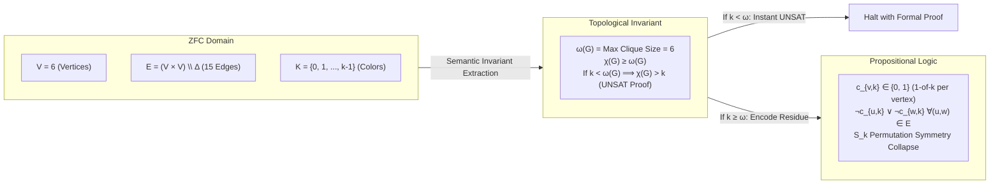
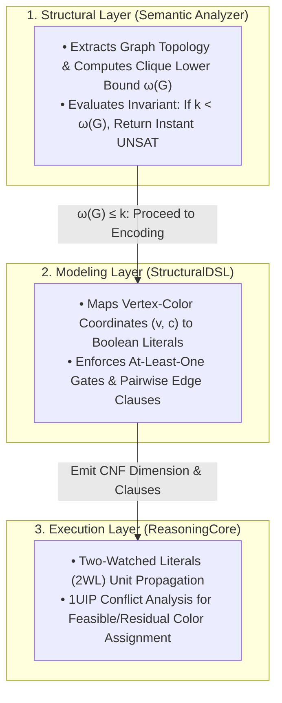

#  Designing a Universal Reasoning Engine: Implementation Guide for Complete Graph ($K_6$) Coloring

This document formalizes the vertex coloring problem on the complete graph $K_6$ within the Structural Complexity Reduction framework. It bridges Zermelo-Fraenkel Set Theory with Choice (ZFC), the chromatic-clique topological invariant, and our 3-tier Python implementation using ReasoningKit.

## 1. Theoretical Bridge: Grounding $K_6$ Coloring in ZFC Set Theory

Determining whether a graph admits a valid $k$-coloring is the canonical NP-complete decision problem $\text{CHROMATIC-NUMBER}$. In raw propositional form, proving that a complete graph $K_n$ cannot be colored with $n - 1$ colors forces a resolution engine to exhaust a dense refutation tree. By formalizing the problem in ZFC, we expose the underlying topological obstruction that enables semantic short-circuiting.


##    The Problem in ZFC Axiomatics

Let the vertex set $V$ be isomorphic to the finite ordinal $6 = \{0, 1, 2, 3, 4, 5\}$, and let the available colors be a finite set $K$ of cardinality $\vert{}K\vert{} = k$.

###    1. Graph Product and Adjacency Relation:

The edge set $E$ of the complete graph $K_6$ is the symmetric, irreflexive relation containing all unordered pairs over $V$:

$$E = \{ \{u, v\} \in \mathcal{P}(V) : u \neq v \}, \quad |E| = \binom{6}{2} = 15$$

The state space of vertex-color assignments is a binary relation $g \subseteq V \times K$.

###    2. The Valid Coloring Invariants:

A proper vertex coloring requires that $g$ defines a total function $g: V \to K$ satisfying the adjacency exclusion axiom:
*    Totality / Existence (Every vertex receives at least one color):

$$\forall v \in V, \, \exists c \in K \text{ such that } (v, c) \in g$$

*    Well-Definedness (Every vertex receives at most one color):

$$\forall v \in V, \, \forall c_1, c_2 \in K, \, \big( (v, c_1) \in g \land (v, c_2) \in g \implies c_1 = c_2 \big)$$

*    Color Exclusivity along Edges (Adjacent vertices differ in color):

$$\forall \{u, v\} \in E, \, \forall c \in K, \, \neg \big( (u, c) \in g \land (v, c) \in g \big)$$

###    3. The Topological Lower Bound Invariant:

In topological graph theory, the chromatic number $\chi(G)$ is bounded from below by the clique number $\omega(G)$ (the cardinality of the largest complete subgraph):

$$\chi(G) \ge \omega(G)$$

For $K_6$, every pair of distinct vertices is adjacent, so the entire graph is its own maximum clique: $\omega(K_6) = 6$.
*    When testing $k = 5$ colors: $k < \omega(K_6) \implies \chi(K_6) > 5$. The semantic layer immediately deduces an unsatisfiability certificate without delegating to the SAT core.
*    When testing $k \ge 6$ colors: the semantic check passes, and the reduced formula is evaluated by the logic engine.

##    2. The 3-Tier Layer Cake Architecture

##    3. Step-by-Step Implementation

###    Step 1: Semantic Short-Circuiting (Topological Proof)

Before transforming the graph into Boolean clauses, we invoke SemanticAnalyzer from ReasoningKit. It constructs an adjacency representation and calculates an estimate of the clique number $\omega(G)$. If $\omega(G) > k$, the formula is provably contradictory, bypassing the exponential clause-generation pipeline entirely.
```python
from ReasoningKit import SemanticAnalyzer

# Define complete graph K6
nodes = list(range(6))
edges = [(u, v) for i, u in enumerate(nodes) for v in nodes[i + 1:]]

# Compute maximum clique lower bound
analyzer = SemanticAnalyzer(nodes, edges)
clique = analyzer.find_max_clique_estimate()

# Topological Invariant Gate
color_budget = 5
if len(clique) > color_budget:
    print(f"UNSAT: Topological proof (omega = {len(clique)} > {color_budget})")
```
##    Step 2: Conceptual Objects and Canonical Mapping

When $k \ge \omega(G)$, we map each vertex-color assignment $(v, c) \in V \times K$ to a unique positive integer literal $X_{v, c} \in \mathbb{N}^+$. We import StructuralDSL directly from ReasoningKit:

```python
from ReasoningKit import StructuralDSL

dsl = StructuralDSL()

# ZFC Mapping: (v, c) -> Canonical Propositional Variable X_{v, c}
# Example: Vertex 2 assigned Color 1
v = 2
c = 1
var_id = dsl.get_var("node", v, "color", c)
```
##    Step 3: Enforcing Structural Invariants

A valid coloring requires each vertex to receive a color, and adjacent vertices to disagree on that color:
1.    Vertex Covering ($\forall v \in V, \, \exists c \in K$): Each vertex has at least one color selected.
2.    Edge Independence ($\forall (u, v) \in E, \, \forall c \in K$): Adjacent vertices cannot share color $c$:

$$\neg \big( X_{u, c} \land X_{v, c} \big) \equiv \big( \neg X_{u, c} \lor \neg X_{v, c} \big)$$

```python
def apply_coloring_invariants(dsl: StructuralDSL, nodes: list[int], edges: list[tuple[int, int]], colors: int) -> None:
    """
    Asserts the proper vertex coloring constraints.
    1. Coverage: Each node receives at least one color.
    2. Conflict: Adjacent nodes cannot share the same color.
    """
    # 1. Coverage: \forall v \in V, \bigvee_{c} X_{v, c}
    for n in nodes:
        node_colors = [dsl.get_var("node", n, "color", c) for c in range(colors)]
        dsl.add_at_least_one(node_colors)

    # 2. Edge Exclusivity: \forall (u, v) \in E, \forall c \in K, (\neg X_{u, c} \lor \neg X_{v, c})
    for u, v in edges:
        for c in range(colors):
            var_u = dsl.get_var("node", u, "color", c)
            var_v = dsl.get_var("node", v, "color", c)
            dsl.formula.append([-var_u, -var_v])
```
