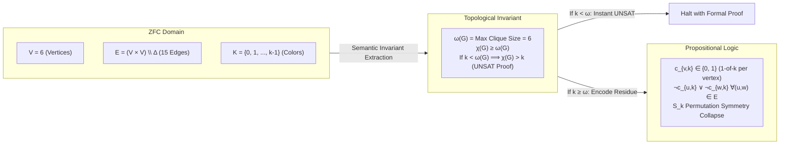

#  Designing a Universal Reasoning Engine: Implementation Guide for Complete Graph ($K_6$) Coloring

This document formalizes the vertex coloring problem on the complete graph $K_6$ within the Structural Complexity Reduction framework. It bridges Zermelo-Fraenkel Set Theory with Choice (ZFC), the chromatic-clique topological invariant, and our 3-tier Python implementation using ReasoningKit.

## 1. Theoretical Bridge: Grounding $K_6$ Coloring in ZFC Set Theory

Determining whether a graph admits a valid $k$-coloring is the canonical NP-complete decision problem $\text{CHROMATIC-NUMBER}$. In raw propositional form, proving that a complete graph $K_n$ cannot be colored with $n - 1$ colors forces a resolution engine to exhaust a dense refutation tree. By formalizing the problem in ZFC, we expose the underlying topological obstruction that enables semantic short-circuiting.

