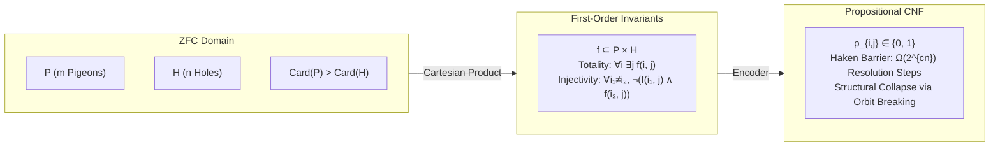

# 1. Theoretical Bridge: Grounding PHP in ZFC Set Theory

In standard proof complexity, $\text{PHP}_n^{m}$ (asserting that $m$ pigeons placed into $n$ holes with $m > n$ 
requires at least one hole to contain more than one pigeon) serves as the canonical hard benchmark for 
resolution-based automated theorem provers.

## The Inherent Inconsistency in ZFC Axiomatics

Let the set of pigeons be $P$ with finite cardinality $\vert{}P\vert{} = m$, and the set of holes be $H$ with $\vert{}H\vert{} = n$, where $m > n$ ($m, n \in \omega$).
1.    Cartesian State Space:

By the Axiom of Pairing and Axiom of Union, we construct:

$$P \times H = \{ (i, j) : i \in P \land j \in H \}$$

A distribution of pigeons into holes is a binary relation $f \subseteq P \times H$.

2.    The Injective Total Function Invariants:

The formula $\text{PHP}_n^m$ attempts to assert that $f$ is both total and strictly injective:
*    Totality / Existence (Every pigeon occupies at least one hole):

$$\forall i \in P, \, \exists j \in H \text{ such that } (i, j) \in f$$

*    Well-Definedness (Every pigeon occupies at most one hole):

$$\forall i \in P, \, \forall j_1, j_2 \in H, \, \big( (i, j_1) \in f \land (i, j_2) \in f \implies j_1 = j_2 \big)$$

*    Injectivity / Hole Exclusivity (No two pigeons share a hole):

$$\forall i_1, i_2 \in P \, (i_1 \neq i_2), \, \forall j \in H, \, \neg \big( (i_1, j) \in f \land (i_2, j) \in f \big)$$

The Dedekind Finite Contradiction:In ZFC, a finite set $H$ cannot be put into one-to-one correspondence with a proper superset $P$ without violating the definition of finite ordinals. Thus:

$$\text{Inj}(P, H) = \emptyset \quad \Longleftrightarrow \quad \text{PHP}_n^m \models \bot$$

The Haken Resolution Barrier & Structural Resolution:

Armin Haken (1985) proved that any propositional resolution refutation of raw $\text{PHP}_n^{n+1}$ requires:

$$\Omega(2^{c \cdot n})$$

resolution steps. A standard CDCL engine executing without pre-search structural reduction evaluates symmetric sub-assignments repeatedly, learning exponentially redundant conflict clauses. To defeat this lower bound, the Structural Layer must collapse the automorphism group before the CDCL loop initializes.
