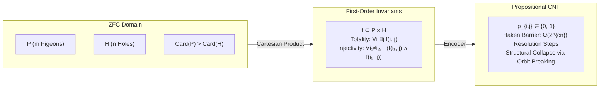

# 1. Theoretical Bridge: Grounding PHP in ZFC Set Theory

In standard proof complexity, $\text{PHP}_n^{m}$ (asserting that $m$ pigeons placed into $n$ holes with $m > n$ 
requires at least one hole to contain more than one pigeon) serves as the canonical hard benchmark for 
resolution-based automated theorem provers.

