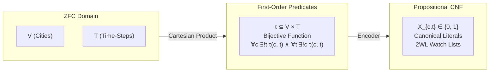
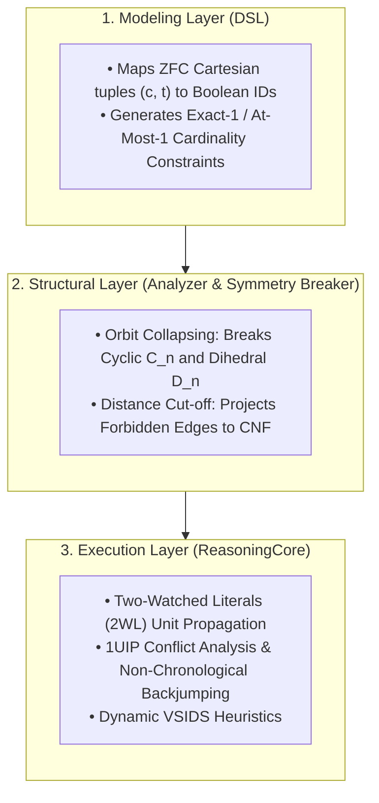

## Designing a Universal Reasoning Engine: Implementation Guide for the Traveling Salesperson Problem (TSP)
This guide documents the theoretical foundations, Zermelo-Fraenkel Set Theory with Choice (ZFC) formalisms, and 
software architecture required to solve the Traveling Salesperson Problem (TSP) within a Structural Complexity Reduction framework.

## 1. Theoretical Bridge: Grounding Propositional Search in ZFC Set Theory
A typical algorithmic failure mode is treating Boolean SAT variables as ungrounded integer indices. In our architecture, the Modeling Layer (DSL) acts as a constructive compiler that formalizes abstract mathematical relations from ZFC set theory into an exact propositional calculus.

### The Problem in ZFC Axiomaics
Let the set of cities be a finite set $V$ with cardinality $\vert{}V\vert{} = n \in \omega$. The tour ordering is indexed by the finite ordinal $T = n = \{0, 1, \dots, n - 1\}$.

|ZFC Domain     |                    |First-Order Predicates    |                  |Propositional CNF|
| V (Cities)    | |──(Cartesian)──►| | τ ⊆ V × T               | |──(Encoder)──►| | X_{c,t} ∈ {0, 1}|
|T (Time-Steps) |  |  Product      | |Bijective Function                           |Canonical Literals|
                        ||           |∀c ∃!t τ(c, t) ∧ ∀t ∃!c τ(c, t)|         | 2WL Watch Lists|

1. Cartesian Product & State Space:

By the Axiom of Pairing and Axiom of Union, we construct the Cartesian product:

$$V \times T = \{ (c, t) : c \in V \land t \in T \}$$

A candidate tour $\tau$ is a relation $\tau \subseteq V \times T$.

2. The Bijection Axiom (Hamiltonian Invariant):

By the Axiom of Specification, the admissible set of cyclic tours $\mathcal{T}_{\text{valid}}$ requires that $\tau$ is a bijection:

$$\tau : V \longleftrightarrow T$$

In first-order logic, this decomposes into two orthogonal uniqueness requirements:

Totality & Well-Definedness (Time Uniqueness):

$$\forall c \in V, \, \exists ! t \in T \text{ such that } (c, t) \in \tau $$

* Injectivity & Surjectivity (Space Uniqueness):

$$\forall t \in T, \, \exists ! c \in V \text{ such that } (c, t) \in \tau$$

3. Metric Grounding & Sub-tour Elimination:

Given a metric space $(V, d)$ where $d: V \times V \to \mathbb{R}_{\ge 0}$, an edge transition relation $E_W \subseteq V \times V$ parameterized by an edge-weight bottleneck $W$ is defined as:

$$E_W = \{ (u, v) \in V \times V : u \neq v \land d(u, v) \le W \}$$

Any tour $\tau$ is bounded by $W$ if and only if consecutive sequence images satisfy the edge relation:

$$\forall t \in T, \, \big( \tau^{-1}(t), \, \tau^{-1}((t + 1) \bmod n) \big) \in E_W$$

## 2. The 3-Tier Layer Cake Architecture


## 3. Step-by-Step Implementation

### Step 1: Conceptual Objects and Canonical Mapping

Every tuple $(c, t) \in V \times T$ maps injectively to a propositional literal $X_{c, t} \in \mathbb{N}^+$. The class StructuralDSL maintains this bijection using a hash table, ensuring referential integrity across constraints.

```python
class StructuralDSL:
    def __init__(self):
        self.formula = []
        self.var_count = 0
        self.var_map = {}

    def get_var(self, *tags):
        """
        ZFC Mapping: (c, t) -> Unique Boolean Literal ID.
        Ensures a collision-free bijection between set-theoretic coordinates
        and the propositional propositional atoms.
        """
        if tags not in self.var_map:
            self.var_count += 1
            self.var_map[tags] = self.var_count
        return self.var_map[tags]

    def add_at_least_one(self, variables):
        """Axiom of Existence: \bigvee_{i} v_i"""
        self.formula.append(list(variables))

    def add_at_most_one(self, variables):
        """
        Axiom of Uniqueness: Pairwise mutually exclusive implications.
        \forall i < j, (\neg v_i \lor \neg v_j)
        """
        for i in range(len(variables)):
            for j in range(i + 1, len(variables)):
                self.formula.append([-variables[i], -variables[j]])

    def add_exactly_one(self, variables):
        """Axiom of Unique Existence: \exists! v \iff (ALO \land AMO)"""
        self.add_at_least_one(variables)
        self.add_at_most_one(variables)
```
### Step 2: Enforcing Structural Invariants

The bijection $\tau : V \longleftrightarrow T$ is asserted by generating $2n$ cardinality gates.
```python
def apply_hamiltonian_invariants(dsl, n):
    # Invariant A: Space Uniqueness (Every time-slot t has exactly one city)
    # \forall t \in T, \exists! c \in V: (c, t) \in \tau
    for t in range(n):
        slot_occupants = [dsl.get_var("city", c, "pos", t) for c in range(n)]
        dsl.add_exactly_one(slot_occupants)

    # Invariant B: Time Uniqueness (Every city c appears at exactly one time-slot)
    # \forall c \in V, \exists! t \in T: (c, t) \in \tau
    for c in range(n):
        city_schedule = [dsl.get_var("city", c, "pos", t) for t in range(n)]
        dsl.add_exactly_one(city_schedule)
```
### Step 3: Search Space Pruning via Symmetry Breaking

A raw TSP on $n$ vertices has an unpruned search space of $n!$ configurations. However, any valid Hamiltonian cycle exhibits automorphism under the Dihedral Group $D_n$ (order $2n$):
*  Cyclic Shift Symmetry ($C_n$): A cyclic shift of positions does not alter path weight:
$$\tau' = (c_0, c_1, \dots, c_{n-1}) \cong (c_k, c_{k+1}, \dots, c_{k-1})$$
*  Reflectional/Reversal Symmetry ($\mathbb{Z}_2$): Traversing clockwise vs. counter-clockwise:
$$\tau_{\text{rev}} = (c_0, c_{n-1}, \dots, c_1)$$

We prune the search space by a factor of $2n$ before the solver makes its first decision:
```python
def apply_symmetry_breaking(dsl, n):
    """
    1. Cyclic Orbit Collapsing:
       Fix City 0 at Position 0. This forces the cycle to anchor at origin,
       collapsing the C_n symmetry group by a factor of n.
    """
    c0_p0 = dsl.get_var("city", 0, "pos", 0)
    dsl.formula.append([c0_p0]) # Injected as a Unit Fact

    """
    2. Reflection Orbit Collapsing:
       Force the city at Position 1 to have a strictly smaller index
       than the city at Position n-1. Collapses the Z_2 reflection group.
       \forall c_a > c_b: \neg (City_{c_a, 1} \land City_{c_b, n-1})
    """
    for ca in range(n):
        for cb in range(ca + 1, n):
            # Prohibit ca at position 1 if cb appears at position n-1
            var_ca_p1 = dsl.get_var("city", ca, "pos", 1)
            var_cb_pend = dsl.get_var("city", cb, "pos", n - 1)
            dsl.formula.append([-var_ca_p1, -var_cb_pend])
```
### Step 4: Metric Projection & Forbidden Transition Gates

Instead of calculating arithmetic sums within propositional clauses, we apply a Metric Filter. Given a candidate bottleneck limit $W$, any pair of cities whose distance exceeds $W$ cannot be adjacent in time.

$$\forall u, v \in V \text{ where } d(u, v) > W \implies \forall t \in T, \; \neg \big( \tau(u) = t \land \tau(v) = (t + 1) \bmod n \big)$$

Converted to Conjunctive Normal Form via De Morgan's Laws:

$$\big( \neg X_{u, t} \lor \neg X_{v, (t+1) \bmod n} \big)$$

```python
def apply_metric_pruning(dsl, n, dist_matrix, max_edge_weight):
    """
    Translates physical distance violations into binary conflict clauses.
    Two-Watched Literals (2WL) propagates these conflicts in O(1) time.
    """
    for u in range(n):
        for v in range(n):
            if u == v:
                continue
            if dist_matrix[u][v] > max_edge_weight:
                for t in range(n):
                    next_t = (t + 1) % n
                    var_u_t = dsl.get_var("city", u, "pos", t)
                    var_v_next = dsl.get_var("city", v, "pos", next_t)
                    dsl.formula.append([-var_u_t, -var_v_next])
```
## 4. Complete Execution Pipeline: The Bottleneck TSP Solver

This end-to-end script integrates the ZFC structural encoding with the ReasoningCore CDCL solver, finding the optimal minimax tour via a binary search over distinct metric edge costs:
```python
import time
from collections import defaultdict

# ============================================================================
# ReasoningCore Engine (2WL, 1UIP Conflict Analysis, VSIDS)
# ============================================================================
class ReasoningCore:
    def __init__(self, formula, num_vars):
        self.formula = [list(c) for c in formula]
        self.num_vars = num_vars
        self.assignment = {}
        self.decision_level = 0
        self.trail = []
        self._prop_head = 0
        self.watches = defaultdict(list)
        
        for c in self.formula:
            self._add_watch(c)
            
        self.vsids_scores = {i: 0.0 for i in range(1, num_vars + 1)}
        self.vsids_inc = 1.0
        self.vsids_decay = 0.95
        self.conflicts = 0
        self.decisions = 0

    def _add_watch(self, clause):
        if len(clause) >= 2:
            self.watches[clause[0]].append(clause)
            self.watches[clause[1]].append(clause)

    def solve(self):
        if self._propagate_initial_units() is not None:
            return None

        while len(self.assignment) < self.num_vars:
            picked_var = self._pick_branching_variable()
            if picked_var is None:
                break

            self.decision_level += 1
            self.decisions += 1
            self._assign(picked_var, False, None)

            while True:
                conflict = self._unit_propagate()
                if conflict is None:
                    break
                
                self.conflicts += 1
                if self.decision_level == 0:
                    return None
                
                learned_clause, backtrack_level, asserting_lit = self._analyze_conflict(conflict)
                
                for lit in learned_clause:
                    self.vsids_scores[abs(lit)] += self.vsids_inc
                self._decay_scores()
                
                self._backtrack(backtrack_level)
                self.decision_level = backtrack_level
                
                self.formula.append(learned_clause)
                self._add_watch(learned_clause)
                self._assign(abs(asserting_lit), asserting_lit > 0, learned_clause)

        return {v: self.assignment[v][0] for v in range(1, self.num_vars + 1)}

    def _pick_branching_variable(self):
        best_var, max_s = None, -1.0
        for v in range(1, self.num_vars + 1):
            if v not in self.assignment and self.vsids_scores[v] > max_s:
                max_s = self.vsids_scores[v]
                best_var = v
        return best_var

    def _unit_propagate(self):
        while self._prop_head < len(self.trail):
            falsified_lit = -self.trail[self._prop_head] if self.assignment[self.trail[self._prop_head]][0] else self.trail[self._prop_head]
            self._prop_head += 1
            watch_list = self.watches[falsified_lit]
            self.watches[falsified_lit] = []
            
            idx = 0
            while idx < len(watch_list):
                clause = watch_list[idx]
                if clause[0] == falsified_lit:
                    clause[0], clause[1] = clause[1], clause[0]
                
                w0_info = self.assignment.get(abs(clause[0]))
                if w0_info and (clause[0] > 0) == w0_info[0]:
                    self.watches[falsified_lit].append(clause)
                    idx += 1
                    continue
                
                found = False
                for j in range(2, len(clause)):
                    l_info = self.assignment.get(abs(clause[j]))
                    if not l_info or (clause[j] > 0) == l_info[0]:
                        clause[1], clause[j] = clause[j], clause[1]
                        self.watches[clause[1]].append(clause)
                        found = True
                        break
                
                if found:
                    idx += 1
                    continue
                
                self.watches[falsified_lit].append(clause)
                w0_info = self.assignment.get(abs(clause[0]))
                if w0_info is None:
                    self._assign(abs(clause[0]), clause[0] > 0, clause)
                elif (clause[0] > 0) != w0_info[0]:
                    self.watches[falsified_lit].extend(watch_list[idx+1:])
                    return clause
                idx += 1
        return None

    def _analyze_conflict(self, conflict_clause):
        learned = set(conflict_clause)
        while True:
            level_lits = [l for l in learned if abs(l) in self.assignment and self.assignment[abs(l)][1] == self.decision_level]
            if len(level_lits) <= 1:
                break
            var = next(v for v in reversed(self.trail) if v in {abs(l) for l in level_lits})
            reason = self.assignment[var][2]
            if reason is None:
                break
            val = self.assignment[var][0]
            lit = -var if val else var
            learned.discard(lit)
            for l in reason:
                if abs(l) != var:
                    learned.add(l)
        asserting = [l for l in learned if self.assignment[abs(l)][1] == self.decision_level][0]
        levels = [self.assignment[abs(l)][1] for l in learned if abs(l) in self.assignment and self.assignment[abs(l)][1] < self.decision_level]
        return list(learned), max(levels, default=0), asserting

    def _backtrack(self, level):
        while self.trail:
            var = self.trail[-1]
            if self.assignment[var][1] <= level:
                break
            self.trail.pop()
            del self.assignment[var]
        self._prop_head = len(self.trail)

    def _assign(self, var, value, reason):
        self.assignment[var] = (value, self.decision_level, reason)
        self.trail.append(var)

    def _decay_scores(self):
        for v in self.vsids_scores:
            self.vsids_scores[v] *= self.vsids_decay

    def _propagate_initial_units(self):
        for clause in self.formula:
            if len(clause) == 1:
                lit = clause[0]
                var, val = abs(lit), lit > 0
                if var in self.assignment and self.assignment[var][0] != val:
                    return clause
                self._assign(var, val, clause)
        return self._unit_propagate()

# ============================================================================
# High-Level TSP Model Orchestrator
# ============================================================================
class TSPSolver:
    def __init__(self, cities, distance_matrix):
        self.n = cities
        self.dist = distance_matrix

    def solve_bounded(self, max_edge_weight):
        dsl = StructuralDSL()

        # 1. Structural Invariants (ZFC Bijection)
        apply_hamiltonian_invariants(dsl, self.n)

        # 2. Symmetry Breaking (Orbit Collapsing)
        apply_symmetry_breaking(dsl, self.n)

        # 3. Metric Filtering (Exclusion Clauses)
        apply_metric_pruning(dsl, self.n, self.dist, max_edge_weight)

        # 4. Deductive Search Execution
        solver = ReasoningCore(dsl.formula, dsl.var_count)
        assignment = solver.solve()

        if assignment is None:
            return None

        # Reconstruct the cycle from boolean variables
        tour = [-1] * self.n
        for t in range(self.n):
            for c in range(self.n):
                vid = dsl.get_var("city", c, "pos", t)
                if assignment.get(vid, False):
                    tour[t] = c
                    break
        return tour

    def optimize(self):
        print(f"--- [TSP] Starting Reasoning Engine Optimization ({self.n} Cities) ---")
        
        # Collect distinct edge weights present in metric space
        weights = sorted({self.dist[i][j] for i in range(self.n) for j in range(self.n) if i != j})
        
        low = 0
        high = len(weights) - 1
        optimal_tour = None
        optimal_bottleneck = -1

        start_time = time.perf_counter()

        # Binary search over distinct bottleneck distances
        while low <= high:
            mid = low + (high - low) // 2
            threshold = weights[mid]
            print(f"  Evaluating Bottleneck Bound <= {threshold:2d} ... ", end="", flush=True)

            tour = self.solve_bounded(threshold)
            if tour is not None:
                print("[FEASIBLE]")
                optimal_tour = tour
                optimal_bottleneck = threshold
                high = mid - 1  # Attempt tighter bound
            else:
                print("[INFEASIBLE]")
                low = mid + 1   # Relax bound

        duration = time.perf_counter() - start_time
        print("\n--- Structural Analysis Complete ---")
        if optimal_tour is None:
            print("No valid Hamiltonian tour exists under the given constraints.")
            return

        total_length = sum(self.dist[optimal_tour[t]][optimal_tour[(t + 1) % self.n]] for t in range(self.n))
        path_str = " -> ".join(str(node) for node in optimal_tour) + f" -> {optimal_tour[0]}"
        print(f"Optimal Minimax Route: {path_str}")
        print(f"Bottleneck Edge Cost: {optimal_bottleneck}")
        print(f"Total Tour Cost:      {total_length}")
        print(f"Execution Wall Time:   {duration:.4f} seconds")


if __name__ == "__main__":
    # Benchmark Metric Space (6-City Metric Distance Matrix)
    distance_matrix = [
        [0,  10, 15, 20, 25, 30],
        [10,  0, 35, 25, 18, 22],
        [15, 35,  0, 30, 28, 12],
        [20, 25, 30,  0, 14, 16],
        [25, 18, 28, 14,  0, 24],
        [30, 22, 12, 16, 24,  0]
    ]

    tsp_engine = TSPSolver(6, distance_matrix)
    tsp_engine.optimize()
```
