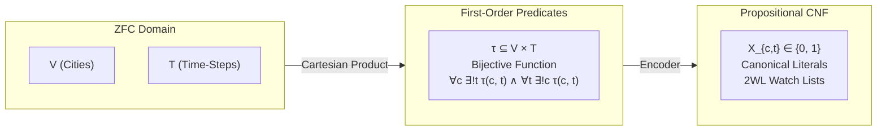
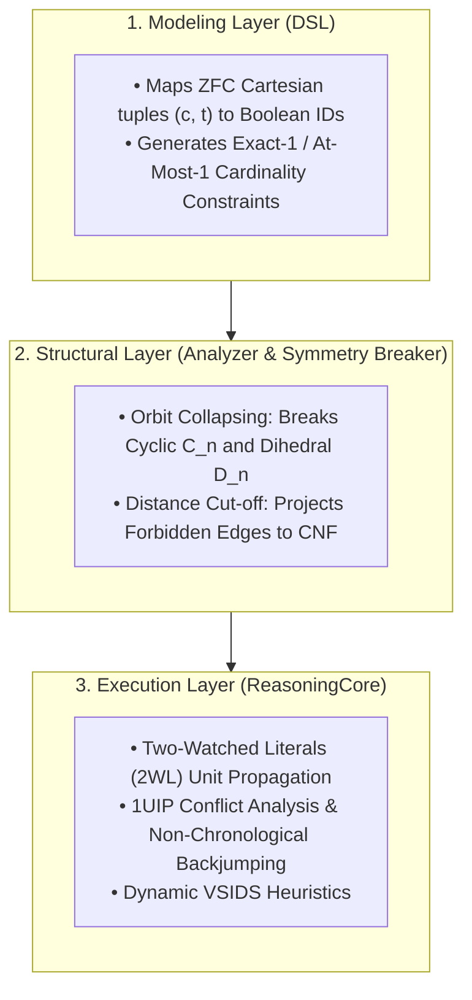

## Designing a Universal Reasoning Engine: Implementation Guide for the Traveling Salesperson Problem (TSP)
This guide documents the theoretical foundations, Zermelo-Fraenkel Set Theory with Choice (ZFC) formalisms, and 
software architecture required to solve the Traveling Salesperson Problem (TSP) within a Structural Complexity Reduction framework.

## 1. Theoretical Bridge: Grounding Propositional Search in ZFC Set Theory
A typical algorithmic failure mode is treating Boolean SAT variables as ungrounded integer indices. In our architecture, the Modeling Layer (DSL) acts as a constructive compiler that formalizes abstract mathematical relations from ZFC set theory into an exact propositional calculus.

### The Problem in ZFC Axiomaics
Let the set of cities be a finite set $V$ with cardinality $\vert{}V\vert{} = n \in \omega$. The tour ordering is indexed by the finite ordinal $T = n = \{0, 1, \dots, n - 1\}$.

|ZFC Domain     |  |                  First-Order Predicates    |        |         Propositional CNF|
| V (Cities)    | |──(Cartesian)──►| | τ ⊆ V × T               | |──(Encoder)──►| | X_{c,t} ∈ {0, 1}|
|T (Time-Steps) |  |  Product      | |Bijective Function         |         ||          |Canonical Literals|
                        ||           |∀c ∃!t τ(c, t) ∧ ∀t ∃!c τ(c, t)|     ||    | 2WL Watch Lists|

1. Cartesian Product & State Space:

By the Axiom of Pairing and Axiom of Union, we construct the Cartesian product:

$$V \times T = \{ (c, t) : c \in V \land t \in T \}$$

A candidate tour $\tau$ is a relation $\tau \subseteq V \times T$.

2. The Bijection Axiom (Hamiltonian Invariant):

By the Axiom of Specification, the admissible set of cyclic tours $\mathcal{T}_{\text{valid}}$ requires that $\tau$ is a bijection:

$$\tau : V \longleftrightarrow T$$

In first-order logic, this decomposes into two orthogonal uniqueness requirements:

Totality & Well-Definedness (Time Uniqueness):

$$\forall c \in V, \, \exists ! t \in T \text{ such that } (c, t) \in \tau $$

* Injectivity & Surjectivity (Space Uniqueness):

$$\forall t \in T, \, \exists ! c \in V \text{ such that } (c, t) \in \tau$$

3. Metric Grounding & Sub-tour Elimination:

Given a metric space $(V, d)$ where $d: V \times V \to \mathbb{R}_{\ge 0}$, an edge transition relation $E_W \subseteq V \times V$ parameterized by an edge-weight bottleneck $W$ is defined as:

$$E_W = \{ (u, v) \in V \times V : u \neq v \land d(u, v) \le W \}$$

Any tour $\tau$ is bounded by $W$ if and only if consecutive sequence images satisfy the edge relation:

$$\forall t \in T, \, \big( \tau^{-1}(t), \, \tau^{-1}((t + 1) \bmod n) \big) \in E_W$$

## 2. The 3-Tier Layer Cake Architecture


## 3. Step-by-Step Implementation

### Step 1: Conceptual Objects and Canonical Mapping

Every tuple $(c, t) \in V \times T$ maps injectively to a propositional literal $X_{c, t} \in \mathbb{N}^+$. The class StructuralDSL maintains this bijection using a hash table, ensuring referential integrity across constraints.

```python
class StructuralDSL:
    def __init__(self):
        self.formula = []
        self.var_count = 0
        self.var_map = {}

    def get_var(self, *tags):
        """
        ZFC Mapping: (c, t) -> Unique Boolean Literal ID.
        Ensures a collision-free bijection between set-theoretic coordinates
        and the propositional propositional atoms.
        """
        if tags not in self.var_map:
            self.var_count += 1
            self.var_map[tags] = self.var_count
        return self.var_map[tags]

    def add_at_least_one(self, variables):
        """Axiom of Existence: \bigvee_{i} v_i"""
        self.formula.append(list(variables))

    def add_at_most_one(self, variables):
        """
        Axiom of Uniqueness: Pairwise mutually exclusive implications.
        \forall i < j, (\neg v_i \lor \neg v_j)
        """
        for i in range(len(variables)):
            for j in range(i + 1, len(variables)):
                self.formula.append([-variables[i], -variables[j]])

    def add_exactly_one(self, variables):
        """Axiom of Unique Existence: \exists! v \iff (ALO \land AMO)"""
        self.add_at_least_one(variables)
        self.add_at_most_one(variables)
```
### Step 2: Enforcing Structural Invariants

The bijection $\tau : V \longleftrightarrow T$ is asserted by generating $2n$ cardinality gates.
```python
def apply_hamiltonian_invariants(dsl, n):
    # Invariant A: Space Uniqueness (Every time-slot t has exactly one city)
    # \forall t \in T, \exists! c \in V: (c, t) \in \tau
    for t in range(n):
        slot_occupants = [dsl.get_var("city", c, "pos", t) for c in range(n)]
        dsl.add_exactly_one(slot_occupants)

    # Invariant B: Time Uniqueness (Every city c appears at exactly one time-slot)
    # \forall c \in V, \exists! t \in T: (c, t) \in \tau
    for c in range(n):
        city_schedule = [dsl.get_var("city", c, "pos", t) for t in range(n)]
        dsl.add_exactly_one(city_schedule)
```
### Step 3: Search Space Pruning via Symmetry Breaking

A raw TSP on $n$ vertices has an unpruned search space of $n!$ configurations. However, any valid Hamiltonian cycle exhibits automorphism under the Dihedral Group $D_n$ (order $2n$):
*  Cyclic Shift Symmetry ($C_n$): A cyclic shift of positions does not alter path weight:

$$\tau' = (c_0, c_1, \dots, c_{n-1}) \cong (c_k, c_{k+1}, \dots, c_{k-1})$$

*  Reflectional/Reversal Symmetry ($\mathbb{Z}_2$): Traversing clockwise vs. counter-clockwise:

$$\tau_{\text{rev}} = (c_0, c_{n-1}, \dots, c_1)$$

We prune the search space by a factor of $2n$ before the solver makes its first decision:
```python
def apply_symmetry_breaking(dsl, n):
    """
    1. Cyclic Orbit Collapsing:
       Fix City 0 at Position 0. This forces the cycle to anchor at origin,
       collapsing the C_n symmetry group by a factor of n.
    """
    c0_p0 = dsl.get_var("city", 0, "pos", 0)
    dsl.formula.append([c0_p0]) # Injected as a Unit Fact

    """
    2. Reflection Orbit Collapsing:
       Force the city at Position 1 to have a strictly smaller index
       than the city at Position n-1. Collapses the Z_2 reflection group.
       \forall c_a > c_b: \neg (City_{c_a, 1} \land City_{c_b, n-1})
    """
    for ca in range(n):
        for cb in range(ca + 1, n):
            # Prohibit ca at position 1 if cb appears at position n-1
            var_ca_p1 = dsl.get_var("city", ca, "pos", 1)
            var_cb_pend = dsl.get_var("city", cb, "pos", n - 1)
            dsl.formula.append([-var_ca_p1, -var_cb_pend])
```
### Step 4: Metric Projection & Forbidden Transition Gates

Instead of calculating arithmetic sums within propositional clauses, we apply a Metric Filter. Given a candidate bottleneck limit $W$, any pair of cities whose distance exceeds $W$ cannot be adjacent in time.

$$\forall u, v \in V \text{ where } d(u, v) > W \implies \forall t \in T, \; \neg \big( \tau(u) = t \land \tau(v) = (t + 1) \bmod n \big)$$

Converted to Conjunctive Normal Form via De Morgan's Laws:

$$\big( \neg X_{u, t} \lor \neg X_{v, (t+1) \bmod n} \big)$$

```python
def apply_metric_pruning(dsl, n, dist_matrix, max_edge_weight):
    """
    Translates physical distance violations into binary conflict clauses.
    Two-Watched Literals (2WL) propagates these conflicts in O(1) time.
    """
    for u in range(n):
        for v in range(n):
            if u == v:
                continue
            if dist_matrix[u][v] > max_edge_weight:
                for t in range(n):
                    next_t = (t + 1) % n
                    var_u_t = dsl.get_var("city", u, "pos", t)
                    var_v_next = dsl.get_var("city", v, "pos", next_t)
                    dsl.formula.append([-var_u_t, -var_v_next])
```
## 4. Complete Execution Pipeline: The Bottleneck TSP Solver

This end-to-end script integrates the ZFC structural encoding with the ReasoningCore CDCL solver, finding the optimal minimax tour via a binary search over distinct metric edge costs:
```python
"""
Pattern: Combinatorial Permutation with Minimax Metric Filtering
Use Case: Traveling Salesperson Problem (TSP)
Methodology: Structural Bijection + Dihedral Orbit Collapsing + CDCL Core
"""

import time
from ReasoningKit import StructuralDSL, ReasoningCore

# ============================================================================
# Step 2: Enforcing Structural Invariants (ZFC Bijection: V <-> T)
# ============================================================================
def apply_hamiltonian_invariants(dsl: StructuralDSL, n: int) -> None:
    """
    Asserts that the tour mapping tau: V -> T is a bijective function.
    - Space Uniqueness: Every time slot t in T is occupied by exactly one city.
    - Time Uniqueness: Every city c in V is scheduled at exactly one time slot.
    """
    # Invariant A: Space Uniqueness (\forall t \in T, \exists! c \in V)
    for t in range(n):
        slot_occupants = [dsl.get_var("city", c, "pos", t) for c in range(n)]
        dsl.add_exactly_one(slot_occupants)

    # Invariant B: Time Uniqueness (\forall c \in V, \exists! t \in T)
    for c in range(n):
        city_schedule = [dsl.get_var("city", c, "pos", t) for t in range(n)]
        dsl.add_exactly_one(city_schedule)


# ============================================================================
# Step 3: Search Space Pruning via Symmetry Breaking (Aut(D_n) Collapsing)
# ============================================================================
def apply_symmetry_breaking(dsl: StructuralDSL, n: int) -> None:
    """
    Prunes the 2n isomorphic search spaces generated by Dihedral Group D_n.
    1. Cyclic Shift (C_n): Fix City 0 at Position 0.
    2. Path Reversal (Z_2): Enforce City at Pos 1 < City at Pos (n-1).
    """
    # 1. Cyclic Orbit Collapsing (Factor of n reduction)
    c0_p0 = dsl.get_var("city", 0, "pos", 0)
    dsl.formula.append([c0_p0])

    # 2. Reflection Orbit Collapsing (Factor of 2 reduction)
    for ca in range(n):
        for cb in range(ca + 1, n):
            var_ca_p1 = dsl.get_var("city", ca, "pos", 1)
            var_cb_pend = dsl.get_var("city", cb, "pos", n - 1)
            dsl.formula.append([-var_ca_p1, -var_cb_pend])


# ============================================================================
# Step 4: Metric Projection & Forbidden Transition Gates
# ============================================================================
def apply_metric_pruning(dsl: StructuralDSL, n: int, dist_matrix: list[list[int]], max_edge_weight: int) -> None:
    """
    Translates metric distance violations into binary conflict clauses:
    ~(City_u_t AND City_v_(t+1)) for any edge where dist(u, v) > threshold.
    """
    for u in range(n):
        for v in range(n):
            if u == v:
                continue
            if dist_matrix[u][v] > max_edge_weight:
                for t in range(n):
                    next_t = (t + 1) % n
                    var_u_t = dsl.get_var("city", u, "pos", t)
                    var_v_next = dsl.get_var("city", v, "pos", next_t)
                    dsl.formula.append([-var_u_t, -var_v_next])


# ============================================================================
# Orchestrator: High-Level TSP Solver
# ============================================================================
class TSPSolver:
    def __init__(self, cities: int, distance_matrix: list[list[int]]):
        self.n = cities
        self.dist = distance_matrix

    def solve_bounded(self, max_edge_weight: int):
        """Constructs constraints and resolves feasibility using the ReasoningCore CDCL engine."""
        dsl = StructuralDSL()

        # 1. Structural Invariants (ZFC Bijection)
        apply_hamiltonian_invariants(dsl, self.n)

        # 2. Symmetry Breaking (Orbit Collapsing)
        apply_symmetry_breaking(dsl, self.n)

        # 3. Metric Filtering (Exclusion Clauses)
        apply_metric_pruning(dsl, self.n, self.dist, max_edge_weight)

        # 4. Deductive Search Execution
        solver = ReasoningCore(dsl.formula, dsl.var_count)
        assignment = solver.solve()

        if assignment is None:
            return None

        # Reconstruct the cycle from the assignment model
        tour = [-1] * self.n
        for t in range(self.n):
            for c in range(self.n):
                vid = dsl.get_var("city", c, "pos", t)
                if assignment.get(vid, False):
                    tour[t] = c
                    break
        return tour

    def optimize(self):
        """Finds the optimal minimax edge tour via binary search over distinct metric costs."""
        print(f"--- [TSP] Starting Reasoning Engine Optimization ({self.n} Cities) ---")

        # Collect distinct edge weights present in the metric space
        weights = sorted({self.dist[i][j] for i in range(self.n) for j in range(self.n) if i != j})

        low = 0
        high = len(weights) - 1
        optimal_tour = None
        optimal_bottleneck = -1

        start_time = time.perf_counter()

        # Binary search over distinct bottleneck edge costs
        while low <= high:
            mid = low + (high - low) // 2
            threshold = weights[mid]
            print(f"  Evaluating Bottleneck Bound <= {threshold:2d} ... ", end="", flush=True)

            tour = self.solve_bounded(threshold)
            if tour is not None:
                print("[FEASIBLE]")
                optimal_tour = tour
                optimal_bottleneck = threshold
                high = mid - 1  # Try a tighter bottleneck bound
            else:
                print("[INFEASIBLE]")
                low = mid + 1   # Relax the bottleneck bound

        duration = time.perf_counter() - start_time
        print("\n--- Structural Analysis Complete ---")
        if optimal_tour is None:
            print("No valid Hamiltonian tour exists under the given constraints.")
            return

        total_length = sum(
            self.dist[optimal_tour[t]][optimal_tour[(t + 1) % self.n]]
            for t in range(self.n)
        )
        path_str = " -> ".join(str(node) for node in optimal_tour) + f" -> {optimal_tour[0]}"
        print(f"Optimal Minimax Route: {path_str}")
        print(f"Bottleneck Edge Cost: {optimal_bottleneck}")
        print(f"Total Tour Cost:      {total_length}")
        print(f"Execution Wall Time:   {duration:.4f} seconds")


if __name__ == "__main__":
    # Benchmark Metric Space (6-City Metric Distance Matrix)
    distance_matrix = [
        [0,  10, 15, 20, 25, 30],
        [10,  0, 35, 25, 18, 22],
        [15, 35,  0, 30, 28, 12],
        [20, 25, 30,  0, 14, 16],
        [25, 18, 28, 14,  0, 24],
        [30, 22, 12, 16, 24,  0]
    ]

    tsp_engine = TSPSolver(6, distance_matrix)
    tsp_engine.optimize()
```
## 5. Architectural Comparison: Branch-and-Bound vs. Structural CDCL

|  Dimension |  Classical Branch-and-Bound (Integer Linear Programming) | Reasoning Engine (Structural Deduction / CDCL) |
| :---         |     :---:      |          ---: |
| Search Paradigm   | Relaxation-driven; branches on continuous bounds ($\mathbb{R}^n$) and adds cutting planes.      | Resolution-driven; operates directly on discrete combinatorial space.   |
| Symmetry Handling   | Requires heavy branch-and-cut callbacks to avoid evaluating flipped tours.      | Group Orbit Pruning: Symmetries are removed at the DSL encoding level prior to solving. |    
| Dead-End Pruning  |     Backtracks chronologically to the last LP relaxation node. |  1UIP Clause Learning: Backjumps across non-relevant decision levels directly to the source conflict.| 
| Unit Propagation  |     Re-computes fractional simplex tableaux ($O(n^3)$ worst-case per step). |    Two-Watched Literals: Propagates forced choices with $O(1)$ amortized memory operations.| 
