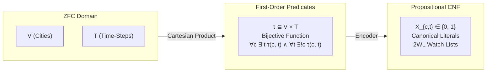
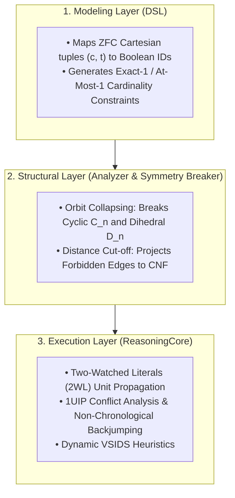

## Designing a Universal Reasoning Engine: Implementation Guide for the Traveling Salesperson Problem (TSP)
This guide documents the theoretical foundations, Zermelo-Fraenkel Set Theory with Choice (ZFC) formalisms, and 
software architecture required to solve the Traveling Salesperson Problem (TSP) within a Structural Complexity Reduction framework.

## 1. Theoretical Bridge: Grounding Propositional Search in ZFC Set Theory
A typical algorithmic failure mode is treating Boolean SAT variables as ungrounded integer indices. In our architecture, the Modeling Layer (DSL) acts as a constructive compiler that formalizes abstract mathematical relations from ZFC set theory into an exact propositional calculus.

### The Problem in ZFC Axiomaics
Let the set of cities be a finite set $V$ with cardinality $\vert{}V\vert{} = n \in \omega$. The tour ordering is indexed by the finite ordinal $T = n = \{0, 1, \dots, n - 1\}$.

|ZFC Domain     |                    |First-Order Predicates    |                  |Propositional CNF|
| V (Cities)    | |──(Cartesian)──►| | τ ⊆ V × T               | |──(Encoder)──►| | X_{c,t} ∈ {0, 1}|
|T (Time-Steps) |  |  Product      | |Bijective Function                           |Canonical Literals|
                        ||           |∀c ∃!t τ(c, t) ∧ ∀t ∃!c τ(c, t)|         | 2WL Watch Lists|

1. Cartesian Product & State Space:

By the Axiom of Pairing and Axiom of Union, we construct the Cartesian product:

$$V \times T = \{ (c, t) : c \in V \land t \in T \}$$

A candidate tour $\tau$ is a relation $\tau \subseteq V \times T$.

2. The Bijection Axiom (Hamiltonian Invariant):

By the Axiom of Specification, the admissible set of cyclic tours $\mathcal{T}_{\text{valid}}$ requires that $\tau$ is a bijection:

$$\tau : V \longleftrightarrow T$$

In first-order logic, this decomposes into two orthogonal uniqueness requirements:

Totality & Well-Definedness (Time Uniqueness):

$$\forall c \in V, \, \exists ! t \in T \text{ such that } (c, t) \in \tau $$

* Injectivity & Surjectivity (Space Uniqueness):

$$\forall t \in T, \, \exists ! c \in V \text{ such that } (c, t) \in \tau$$

3. Metric Grounding & Sub-tour Elimination:

Given a metric space $(V, d)$ where $d: V \times V \to \mathbb{R}_{\ge 0}$, an edge transition relation $E_W \subseteq V \times V$ parameterized by an edge-weight bottleneck $W$ is defined as:

$$E_W = \{ (u, v) \in V \times V : u \neq v \land d(u, v) \le W \}$$

Any tour $\tau$ is bounded by $W$ if and only if consecutive sequence images satisfy the edge relation:

$$\forall t \in T, \, \big( \tau^{-1}(t), \, \tau^{-1}((t + 1) \bmod n) \big) \in E_W$$

## 2. The 3-Tier Layer Cake Architecture

