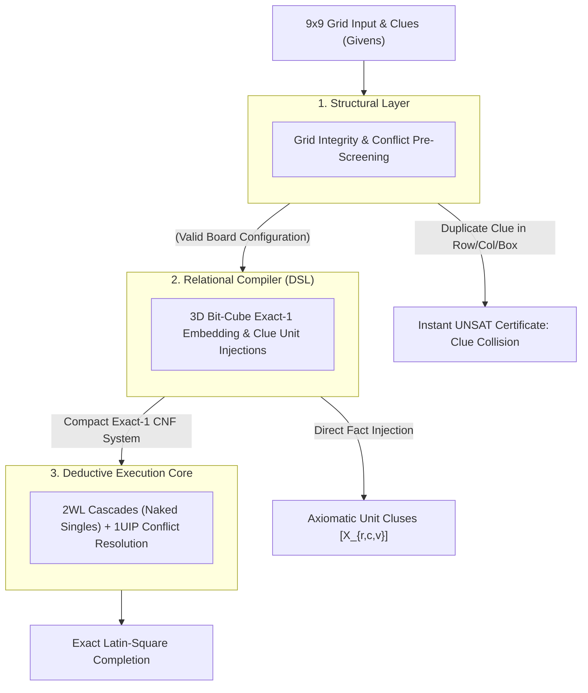

# Designing a Structural Reasoning Engine: Systems Architecture Guide for 9x9 Sudoku


##    1. Core Engineering Philosophy: The 3D Bit-Cube Exact-Cover Model

Standard backtracking solvers treat 9x9 Sudoku as a trial-and-error recursive search, evaluating empty cells chronologically and rewinding when a constraint is violated. This approach scales poorly on adversarial instances ("evil" or minimal 17-clue puzzles) where depth-first paths dead-end after hundreds of speculative branch decisions.

The Reasoning Engine reformulates Sudoku as a 4-Way Dual Orthogonal Exact-Cover System:
*    The 3D Bit-Cube: Rather than storing integers $1..9$ in a 2D array, the state space is modeled as a 3D coordinate system of dimensions $9 \times 9 \times 9 = 729$ binary indicator variables.
*    Structural Intersection: Every valid state must simultaneously satisfy four orthogonal partition invariants: cell occupancy, row Latin coverage, column Latin coverage, and 3x3 block subgrid coverage.
*    Deterministic Unit Cascades: Injecting board clues directly as boolean unit facts triggers a deterministic propagation wave via Two-Watched Literals (2WL), resolving simple and intermediate puzzles with zero search decisions.

##    2. The 3-Tier Layer Cake Architecture

###    Layer 1: Structural Analysis (Pre-Screening Invariants)

Before compiling the board into propositional clauses, the structural layer validates the macro constraints of the provided clues:
*    The Invariant: No row, column, or $3 \times 3$ subgrid can contain duplicate clue values.
*    Execution: A single-pass validation check runs across the input clues. If two identical digits share an axis or block, the engine issues an immediate UNSAT certificate in $O(1)$ time, halting before setting up the solver core.

###    Layer 2: Relational Compiler (Structural DSL)

The compiler translates the 3D bit-cube coordinates into boolean logic:
*    Coordinate Mapping: Maps $(r, c, v)$ to unique integer variable IDs $X_{r, c, v}$.
*    Cardinality Encodings: Generates add_exactly_one constraints across the value dimension for each cell, and add_at_most_one across row, column, and block dimensions for each digit.
*    Clue Injection: Translates board givens into unit clauses ($[X_{r, c, v}]$), locking their truth values at decision level 0.

###    Layer 3: Deductive Execution Core (CDCL / 2WL)

The compiled representation is executed by the deductive solver:
*    Two-Watched Literals (2WL): Unit propagation cascades automatically simulate human solving techniques (e.g., Naked Singles, Hidden Singles) at $O(1)$ amortized cost per literal elimination.
*    1UIP Conflict Resolution: When deep speculative choices conflict on hard puzzles, the engine analyzes the implication graph cut, learns an asserting clause, and backjumps non-chronologically.

##    3. Concrete Implementation: Sudoku Systems Architecture

###    Step 1: Coordinate Space Definition

For a $9 \times 9$ board with digits $1..9$, the state space consists of 729 discrete coordinates:
*    Let Boolean variable cell_{r}_{c}_val_{v} denote: "Row $r$, Column $c$ contains digit $v$."
*    Total variables allocated: $9 \times 9 \times 9 = 729$.

```python
from ReasoningKit import StructuralDSL

dsl = StructuralDSL()

# Discrete Coordinate Registration
# Maps 3D coordinate (row, col, value) directly to bit indices
def get_cell_var(dsl, r, c, v):
    return dsl.get_var(f"cell_{r}_{c}_val_{v}")
```
###    Step 2: Structural Partition Rules

The grid must obey four orthogonal uniqueness invariants:

```python
def apply_sudoku_partition_rules(dsl):
    # Rule 1: Cell Occupancy - Each cell holds exactly one digit (1..9)
    for r in range(9):
        for c in range(9):
            cell_digits = [get_cell_var(dsl, r, c, v) for v in range(1, 10)]
            dsl.add_exactly_one(cell_digits)

    # Rules 2, 3, 4: Axis & Block Exclusivity for each digit
    for v in range(1, 10):
        # Rule 2: Row Exclusivity - Digit v appears at most once per row
        for r in range(9):
            row_cells = [get_cell_var(dsl, r, c, v) for c in range(9)]
            dsl.add_at_most_one(row_cells)

        # Rule 3: Column Exclusivity - Digit v appears at most once per column
        for c in range(9):
            col_cells = [get_cell_var(dsl, r, c, v) for c in range(9)]
            dsl.add_at_most_one(col_cells)

        # Rule 4: 3x3 Block Exclusivity - Digit v appears at most once per block
        for br in range(3):
            for bc in range(3):
                block_cells = [
                    get_cell_var(dsl, br * 3 + dr, bc * 3 + dc, v)
                    for dr in range(3)
                    for dc in range(3)
                ]
                dsl.add_at_most_one(block_cells)
```
###    Step 3: Clue Injection (Axiomatic Unit Clauses)

Board givens are injected directly as unit clauses into dsl.formula. When the solver initializes, these trigger root-level unit propagations across the watch lists before the first branching choice is made.

```python
def inject_puzzle_clues(dsl, grid):
    for r in range(9):
        for c in range(9):
            val = grid[r][c]
            if 1 <= val <= 9:
                # Fixed unit fact: this cell MUST be this digit
                clue_lit = get_cell_var(dsl, r, c, val)
                dsl.formula.append([clue_lit])
```
###    4. Execution Workflow
```python
import time
from ReasoningKit import StructuralDSL, ReasoningCore

def pre_screen_grid(grid):
    """Tier 1: Invariant validation for clue conflicts."""
    for r in range(9):
        for c in range(9):
            val = grid[r][c]
            if val == 0:
                continue
            # Check row and col conflicts
            for i in range(9):
                if i != c and grid[r][i] == val:
                    return False
                if i != r and grid[i][c] == val:
                    return False
            # Check 3x3 block conflicts
            br, bc = (r // 3) * 3, (c // 3) * 3
            for dr in range(3):
                for dc in range(3):
                    nr, nc = br + dr, bc + dc
                    if (nr != r or nc != c) and grid[nr][nc] == val:
                        return False
    return True

def run_sudoku_systems_solver(grid):
    print("--- [Sudoku] Initiating Systems Solver ---")

    # Tier 1: Structural Pre-Screening
    if not pre_screen_grid(grid):
        print("  [Structural Layer] Conflict Detected: Duplicate clue along row/col/block.")
        print("  [Semantic Result] Instant UNSAT Certificate issued.")
        return None

    # Tier 2: Relational Compiler (DSL)
    dsl = StructuralDSL()
    apply_sudoku_partition_rules(dsl)
    inject_puzzle_clues(dsl, grid)

    print(f"  [DSL Compiler] Generated {len(dsl.formula)} clauses across {dsl.var_count} variables.")

    # Tier 3: Deductive Execution Core
    solver = ReasoningCore(dsl.formula, dsl.var_count)

    start_time = time.perf_counter()
    result = solver.solve()
    duration = time.perf_counter() - start_time

    if result is None:
        print("  [CDCL Core] Status: UNSATISFIABLE")
        return None

    print(f"  [CDCL Core] Solved in {duration:.4f}s | Decisions: {solver.decisions} | Conflicts: {solver.conflicts}")

    # Reconstruct 9x9 grid from truth assignments
    solved = [[0] * 9 for _ in range(9)]
    for r in range(9):
        for c in range(9):
            for v in range(1, 10):
                vid = get_cell_var(dsl, r, c, v)
                if result.get(vid, False):
                    solved[r][c] = v
                    break
    return solved


if __name__ == "__main__":
    # Benchmark 9x9 grid (0 denotes empty cell)
    puzzle = [
        [5, 3, 0,  0, 7, 0,  0, 0, 0],
        [6, 0, 0,  1, 9, 5,  0, 0, 0],
        [0, 9, 8,  0, 0, 0,  0, 6, 0],

        [8, 0, 0,  0, 6, 0,  0, 0, 3],
        [4, 0, 0,  8, 0, 3,  0, 0, 1],
        [7, 0, 0,  0, 2, 0,  0, 0, 6],

        [0, 6, 0,  0, 0, 0,  2, 8, 0],
        [0, 0, 0,  4, 1, 9,  0, 0, 5],
        [0, 0, 0,  0, 8, 0,  0, 7, 9]
    ]

    solution = run_sudoku_systems_solver(puzzle)
    if solution:
        print("\n--- Solved Output ---")
        for row in solution:
            print(" ".join(str(n) for n in row))
'''

