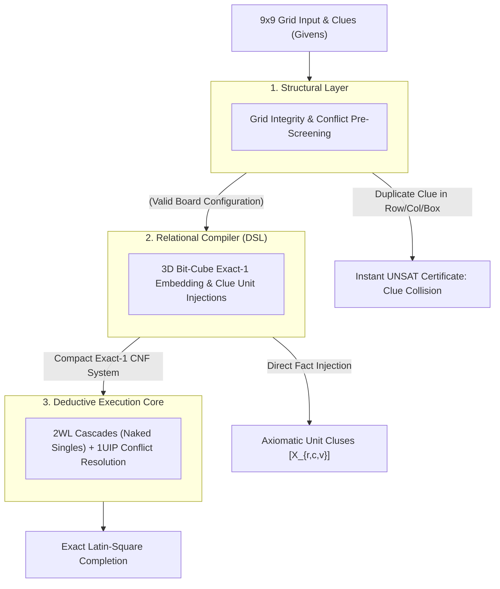

# Designing a Structural Reasoning Engine: Systems Architecture Guide for 9x9 Sudoku


##    1. Core Engineering Philosophy: The 3D Bit-Cube Exact-Cover Model

Standard backtracking solvers treat 9x9 Sudoku as a trial-and-error recursive search, evaluating empty cells chronologically and rewinding when a constraint is violated. This approach scales poorly on adversarial instances ("evil" or minimal 17-clue puzzles) where depth-first paths dead-end after hundreds of speculative branch decisions.

The Reasoning Engine reformulates Sudoku as a 4-Way Dual Orthogonal Exact-Cover System:
*    The 3D Bit-Cube: Rather than storing integers $1..9$ in a 2D array, the state space is modeled as a 3D coordinate system of dimensions $9 \times 9 \times 9 = 729$ binary indicator variables.
*    Structural Intersection: Every valid state must simultaneously satisfy four orthogonal partition invariants: cell occupancy, row Latin coverage, column Latin coverage, and 3x3 block subgrid coverage.
*    Deterministic Unit Cascades: Injecting board clues directly as boolean unit facts triggers a deterministic propagation wave via Two-Watched Literals (2WL), resolving simple and intermediate puzzles with zero search decisions.

##    2. The 3-Tier Layer Cake Architecture

###    Layer 1: Structural Analysis (Pre-Screening Invariants)

Before compiling the board into propositional clauses, the structural layer validates the macro constraints of the provided clues:
*    The Invariant: No row, column, or $3 \times 3$ subgrid can contain duplicate clue values.
*    Execution: A single-pass validation check runs across the input clues. If two identical digits share an axis or block, the engine issues an immediate UNSAT certificate in $O(1)$ time, halting before setting up the solver core.

###    Layer 2: Relational Compiler (Structural DSL)

The compiler translates the 3D bit-cube coordinates into boolean logic:
*    Coordinate Mapping: Maps $(r, c, v)$ to unique integer variable IDs $X_{r, c, v}$.
*    Cardinality Encodings: Generates add_exactly_one constraints across the value dimension for each cell, and add_at_most_one across row, column, and block dimensions for each digit.
*    Clue Injection: Translates board givens into unit clauses ($[X_{r, c, v}]$), locking their truth values at decision level 0.

###    Layer 3: Deductive Execution Core (CDCL / 2WL)

The compiled representation is executed by the deductive solver:
*    Two-Watched Literals (2WL): Unit propagation cascades automatically simulate human solving techniques (e.g., Naked Singles, Hidden Singles) at $O(1)$ amortized cost per literal elimination.
*    1UIP Conflict Resolution: When deep speculative choices conflict on hard puzzles, the engine analyzes the implication graph cut, learns an asserting clause, and backjumps non-chronologically.

##    3. Concrete Implementation: Sudoku Systems Architecture

###    Step 1: Coordinate Space Definition

For a $9 \times 9$ board with digits $1..9$, the state space consists of 729 discrete coordinates:
*    Let Boolean variable cell_{r}_{c}_val_{v} denote: "Row $r$, Column $c$ contains digit $v$."
*    Total variables allocated: $9 \times 9 \times 9 = 729$.

```python
from ReasoningKit import StructuralDSL

dsl = StructuralDSL()

# Discrete Coordinate Registration
# Maps 3D coordinate (row, col, value) directly to bit indices
def get_cell_var(dsl, r, c, v):
    return dsl.get_var(f"cell_{r}_{c}_val_{v}")
```

