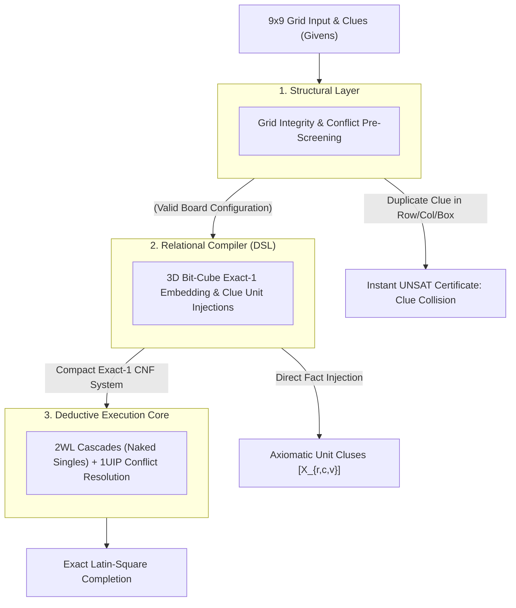

# Designing a Structural Reasoning Engine: Systems Architecture Guide for 9x9 Sudoku

##    1. Core Engineering Philosophy: The 3D Bit-Cube Exact-Cover Model

Standard backtracking solvers treat 9x9 Sudoku as a trial-and-error recursive search, evaluating empty cells chronologically and rewinding when a constraint is violated. This approach scales poorly on adversarial instances ("evil" or minimal 17-clue puzzles) where depth-first paths dead-end after hundreds of speculative branch decisions.

The Reasoning Engine reformulates Sudoku as a 4-Way Dual Orthogonal Exact-Cover System:
*    The 3D Bit-Cube: Rather than storing integers $1..9$ in a 2D array, the state space is modeled as a 3D coordinate system of dimensions $9 \times 9 \times 9 = 729$ binary indicator variables.
*    Structural Intersection: Every valid state must simultaneously satisfy four orthogonal partition invariants: cell occupancy, row Latin coverage, column Latin coverage, and 3x3 block subgrid coverage.
*    Deterministic Unit Cascades: Injecting board clues directly as boolean unit facts triggers a deterministic propagation wave via Two-Watched Literals (2WL), resolving simple and intermediate puzzles with zero search decisions.

