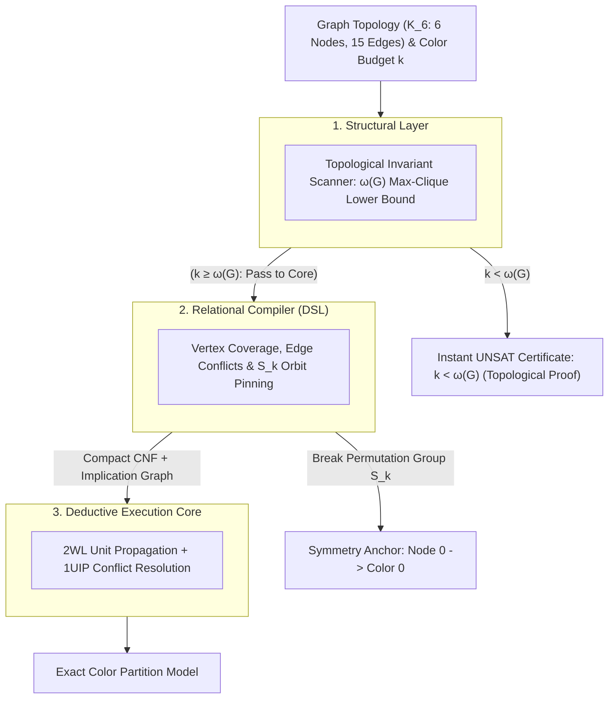

#  Designing a Structural Reasoning Engine: Systems Architecture Guide for Complete Graph ($K_6$) Coloring


##    1. Core Engineering Philosophy: Topological Short-Circuiting

In structural complexity reduction, graph vertex coloring ($\text{CHROMATIC-NUMBER}$) represents an ideal demonstration of Topological Pre-Screening. Proving that a dense, highly connected graph cannot be colored within a given budget $k$ is notoriously difficult for raw resolution engines. In the case of the complete graph $K_6$ tested with $k = 5$ colors, an unguided CDCL solver must evaluate dense permutations of edge conflicts across all nodes, deriving an exponential number of resolution steps before proving unsatisfiability.

The Reasoning Engine avoids this combinatorial search via a Macro-Invariant Filter:
*    The Chromatic-Clique Invariant: In graph theory, the chromatic number $\chi(G)$ (minimum colors required) is strictly bounded from below by the clique number $\omega(G)$ (size of the largest mutually connected subgraph):
*    
$$\chi(G) \ge \omega(G)$$

*    Macro Short-Circuiting: By detecting that $K_6$ contains a 6-clique ($\omega(K_6) = 6$), the engine immediately knows that any budget $k < 6$ is impossible. It issues an instant UNSAT certificate in $O(V + E)$ time without creating a single boolean clause.
*    Automorphism Collapse: If the color budget is feasible ($k \ge 6$), the engine uses the relational compiler to break the factorial color permutation symmetries ($S_k$) before search begins.

##    2. The 3-Tier Layer Cake Architecture

###    Layer 1: Structural Analysis (Topological Invariant Scanner)
Before converting graph vertices and edges into propositional logic:
*    The Invariant: Computes a greedy or exact clique lower bound $\omega(G)$ over the adjacency matrix.
*    Execution: If the requested color budget $k < \omega(G)$, the analyzer returns an immediate UNSAT certificate with a formal topological proof, short-circuiting the CDCL engine entirely.

Layer 2: Relational Compiler (Structural DSL)

When $k \ge \omega(G)$ and an explicit coloring assignment must be found:
*    Coordinate Mapping: Maps each discrete pair $(\text{node}, \text{color})$ to a unique positive integer literal ID $X_{v, c}$.
*    Structural Constraints: Enforces that every vertex receives at least one color (add_at_least_one), while adjacent vertices across all 15 edges cannot share the same color.
*    Symmetry Breaking: Eliminates the $k!$ color-swapping automorphism group ($S_k$) by pinning Node 0 to Color 0.

###    Layer 3: Deductive Execution Core (CDCL / 2WL)

The compiled CNF is solved by the deduction engine:
*    Two-Watched Literals (2WL): Propagates edge exclusions in $O(1)$ amortized memory operations whenever a color choice is made.
*    1UIP Conflict Analysis: If dead-ends occur on sparse variants or subgraphs, the solver isolates the asserting conflict clause and backjumps non-chronologically.

##    3. Concrete Implementation: $K_6$ Systems Architecture

###    Step 1: Coordinate Space DefinitionFor 6 vertices and $k$ colors, the state space is modeled as a $6 \times k$ allocation matrix:
*    Let Boolean variable node_{v}_color_{c} denote: "Vertex $v$ is assigned Color $c$."
*    Total variables allocated: $6 \cdot k$.

```python
from ReasoningKit import StructuralDSL

dsl = StructuralDSL()

# Discrete Coordinate Registration
# Maps the 2D state space (vertex, color) directly to bit indices
def get_color_var(dsl, vertex, color):
    return dsl.get_var(f"node_{vertex}_color_{color}")
```
