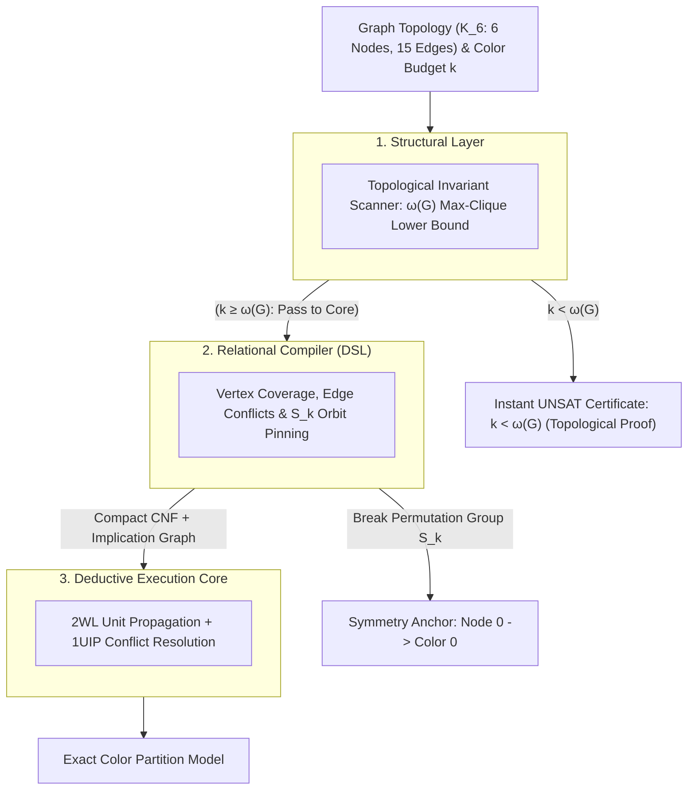

#  Designing a Structural Reasoning Engine: Systems Architecture Guide for Complete Graph ($K_6$) Coloring

##    1. Core Engineering Philosophy: Topological Short-Circuiting

In structural complexity reduction, graph vertex coloring ($\text{CHROMATIC-NUMBER}$) represents an ideal demonstration of Topological Pre-Screening. Proving that a dense, highly connected graph cannot be colored within a given budget $k$ is notoriously difficult for raw resolution engines. In the case of the complete graph $K_6$ tested with $k = 5$ colors, an unguided CDCL solver must evaluate dense permutations of edge conflicts across all nodes, deriving an exponential number of resolution steps before proving unsatisfiability.

The Reasoning Engine avoids this combinatorial search via a Macro-Invariant Filter:
*    The Chromatic-Clique Invariant: In graph theory, the chromatic number $\chi(G)$ (minimum colors required) is strictly bounded from below by the clique number $\omega(G)$ (size of the largest mutually connected subgraph):
*    
$$\chi(G) \ge \omega(G)$$

*    Macro Short-Circuiting: By detecting that $K_6$ contains a 6-clique ($\omega(K_6) = 6$), the engine immediately knows that any budget $k < 6$ is impossible. It issues an instant UNSAT certificate in $O(V + E)$ time without creating a single boolean clause.
*    Automorphism Collapse: If the color budget is feasible ($k \ge 6$), the engine uses the relational compiler to break the factorial color permutation symmetries ($S_k$) before search begins.

