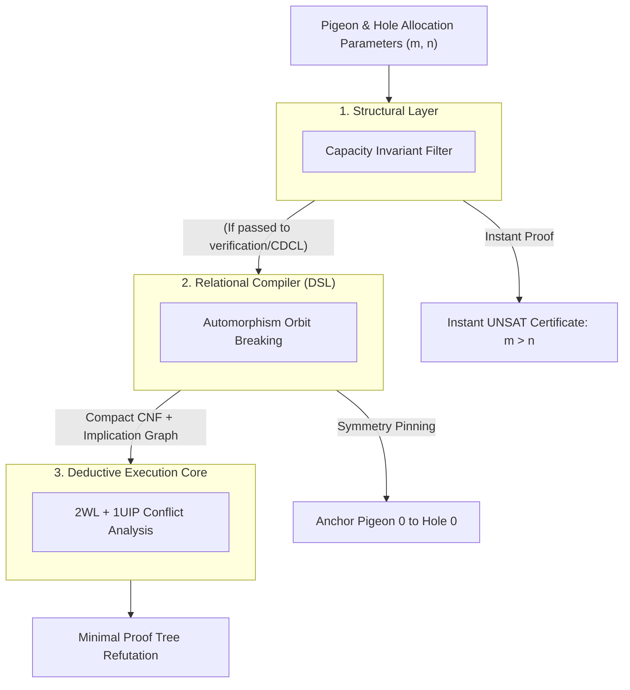

#  Designing a Structural Reasoning Engine: Systems Architecture Guide for the Pigeonhole Principle (PHP)

##  1. Core Engineering Philosophy: Defeating the Haken Resolution Barrier

In computational proof complexity, the Pigeonhole Principle ($\text{PHP}_n^m$, where $m$ items are mapped into $n$ slots with $m > n$) represents the primary counterexample to standard resolution 
systems. Armin Haken established that any general resolution refutation of raw $\text{PHP}_n^{n+1}$ forces a solver to generate:

$$\Omega(2^{c \cdot n})$$

resolution steps.

When a standard CDCL solver operates purely on propositional clauses, it treats each assignment in isolation. It cannot recognize that swapping two pigeons or two holes produces an 
isomorphic subproblem. Consequently, it traverses identical dead-ends, learning an exponential number of symmetric conflict clauses.

The Reasoning Engine circumvents this barrier using a Reduction-First Architecture:
*  Topological Pre-Check: Identifies global counting bottlenecks prior to boolean conversion.
*  Automorphism Collapse: Breaks the factorial permutation symmetries of the entity space at the relational compiler layer.
*  1UIP Pruning: Derives learned clauses on non-symmetric canonical representations to terminate search branches rapidly.

