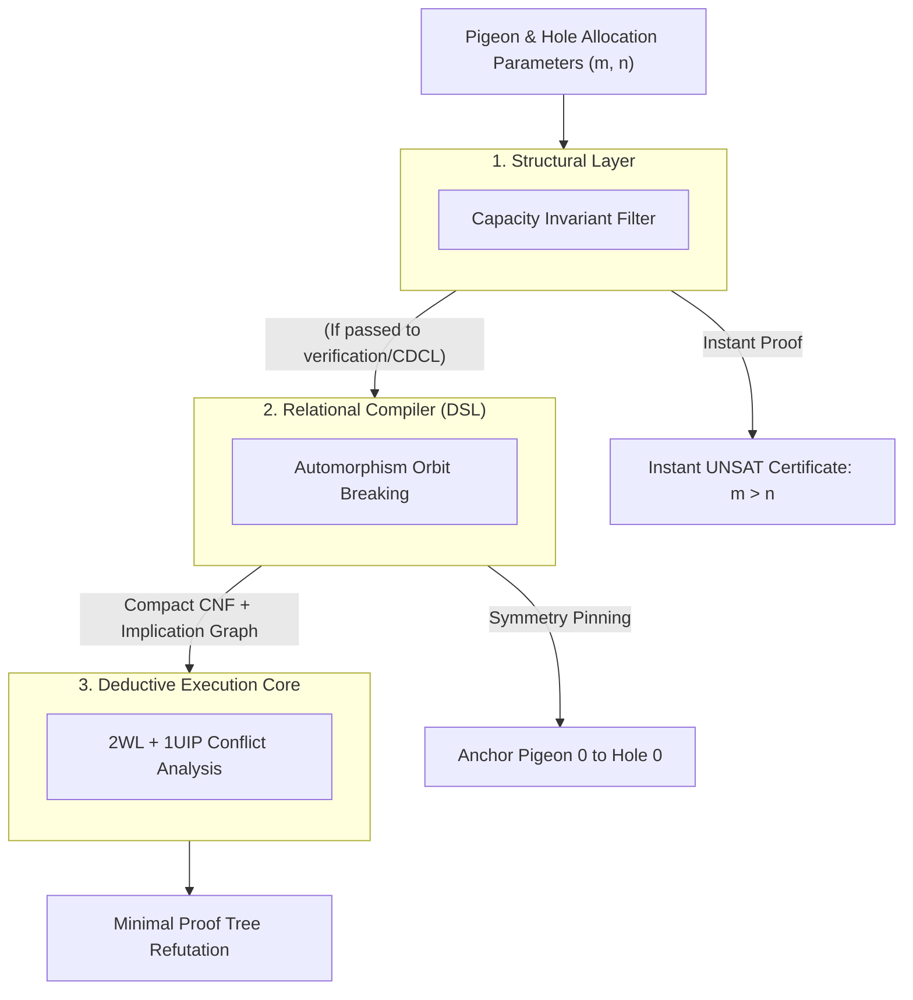

#  Designing a Structural Reasoning Engine: Systems Architecture Guide for the Pigeonhole Principle (PHP)

##  1. Core Engineering Philosophy: Defeating the Haken Resolution Barrier

In computational proof complexity, the Pigeonhole Principle ($\text{PHP}_n^m$, where $m$ items are mapped into $n$ slots with $m > n$) represents the primary counterexample to standard resolution 
systems. Armin Haken established that any general resolution refutation of raw $\text{PHP}_n^{n+1}$ forces a solver to generate:

$$\Omega(2^{c \cdot n})$$

resolution steps.

When a standard CDCL solver operates purely on propositional clauses, it treats each assignment in isolation. It cannot recognize that swapping two pigeons or two holes produces an 
isomorphic subproblem. Consequently, it traverses identical dead-ends, learning an exponential number of symmetric conflict clauses.

The Reasoning Engine circumvents this barrier using a Reduction-First Architecture:
*  Topological Pre-Check: Identifies global counting bottlenecks prior to boolean conversion.
*  Automorphism Collapse: Breaks the factorial permutation symmetries of the entity space at the relational compiler layer.
*  1UIP Pruning: Derives learned clauses on non-symmetric canonical representations to terminate search branches rapidly.


##    2. The 3-Tier Layer Cake Architecture

###    Layer 1: Structural Analysis (Capacity Invariant)

Before generating clauses, the system evaluates the capacity ratio:
*    The Invariant: For any injective mapping from a finite set of items $P$ to slots $H$, capacity dictates that $\vert{}P\vert{} \le \vert{}H\vert{}$.
*    Execution: If $\vert{}P\vert{} > \vert{}H\vert{}$ and the problem demands an injective assignment, the semantic analyzer returns an immediate UNSAT certificate in $O(1)$ time, demonstrating impossibility without initiating boolean resolution.

###    Layer 2: Relational Compiler (Structural DSL)

When evaluating the problem explicitly through propositional reasoning (e.g., verifying solver robustness or handling partial placement constraints), the relational compiler constructs the Boolean representation:
*    Coordinate Mapping: Translates the discrete pairs $(\text{pigeon}, \text{hole})$ into contiguous integer literal IDs.
*    Cardinality Encodings: Enforces that every pigeon has an assigned hole (Exactly-One), while each hole accepts no more than one occupant (At-Most-One).
*    Symmetry Breaking: Eliminates the $m! \times n!$ automorphism group ($S_m \times S_n$) by pinning canonical reference coordinates.

###    Layer 3: Deductive Execution Core (CDCL / 2WL)

The compiled CNF is processed by the deduction engine:
*    Two-Watched Literals (2WL): Monitors boundary conditions with minimal memory overhead during constraint propagation.
*    1UIP Conflict Analysis: When capacity conflicts occur, the solver identifies the root assignment and derives an asserting learned clause that cuts away redundant search subtrees.

##    3. Concrete Implementation: PHP Systems Architecture

###    Step 1: Coordinate Space Definition

For $m$ pigeons and $n$ holes, the state space is modeled as an $m \times n$ allocation grid:
*    Let Boolean variable p_{i}_h_{j} denote: "Pigeon $i$ is assigned to Hole $j$."
*    Total boolean variables registered: $m \cdot n$.

```python
from ReasoningKit import StructuralDSL

dsl = StructuralDSL()

# Discrete Coordinate Registration
# Maps the 2D state space (pigeon_idx, hole_idx) directly to bit indices
def get_pigeon_var(dsl, pigeon_idx, hole_idx):
    return dsl.get_var(f"p_{pigeon_idx}_h_{hole_idx}")
```

