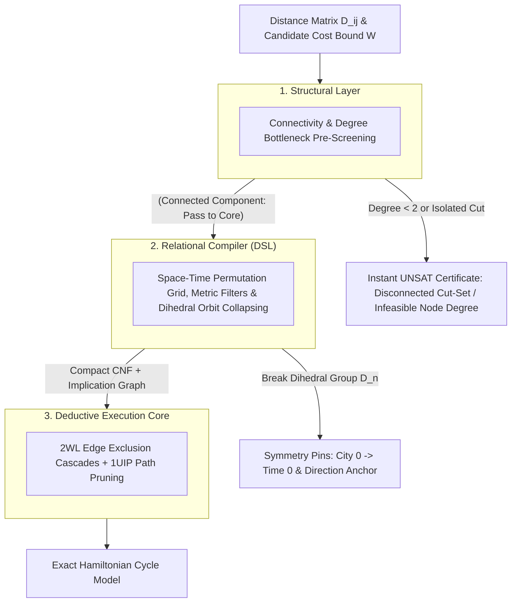

#  Designing a Structural Reasoning Engine: Systems Architecture Guide for the Traveling Salesperson Problem (TSP)



##    1. Core Engineering Philosophy: Permutation Encoding with Metric Filtering
Classical approaches to the Traveling Salesperson Problem (TSP) rely on Integer Linear Programming (ILP) with lazy cutting-plane generation (such as Danzig-Fulkerson-Johnson sub-tour elimination constraints) or Branch-and-Bound over continuous LP relaxations. When instances exhibit dense graphs or intricate combinatorial structures, linear relaxations often weaken, forcing solvers into heavy branch-and-cut exploration.

The Reasoning Engine reformulates TSP as an Exact Space-Time Permutation System with Metric Boundary Exclusion:
*    The Discrete Space-Time Grid: Rather than calculating arithmetic sums inside logic clauses, the tour is represented as an $n \times n$ Boolean coordinate matrix mapping each city to a discrete visit sequence step.
*    Metric Cut Projections: A candidate tour cost or bottleneck limit $W$ is mapped into direct pairwise exclusion clauses. Any edge $(u, v)$ where $\text{dist}(u, v) > W$ is forbidden from occurring consecutively in time:

$$\neg (\text{City}_u \text{ at } t \land \text{City}_v \text{ at } t + 1) \equiv (\neg X_{u, t} \lor \neg X_{v, (t+1) \bmod n})$$
*    Dihedral Automorphism Breaking: A Hamiltonian cycle on $n$ vertices has an automorphism group of order $2n$ ($n$ cyclic shifts and 2 path traversal directions). We eliminate these identical search trees before search begins.

##    2. The 3-Tier Layer Cake Architecture

###    Layer 1: Structural Analysis (Topological & Graph Pre-Screening)

Before generating CNF variables, the structural layer analyzes the connectivity and degree properties of the subgraph formed by edges with weight $\le W$:
*    The Invariant: Every vertex in a valid Hamiltonian cycle must have an undirected degree $\ge 2$. Furthermore, the filtered subgraph must form a single connected component containing all $n$ nodes.
*    Execution: A quick $O(V + E)$ graph traversal (e.g., Breadth-First Search) verifies connectivity and node degrees. If any node has degree $< 2$ or the graph is disconnected, the engine returns an immediate UNSAT certificate without compiling any clauses.

###    Layer 2: Relational Compiler (Structural DSL)

When the filtered topology passes the structural check:
*    Coordinate Mapping: Maps each discrete tuple $(\text{city}, \text{step})$ to a unique positive integer literal ID $X_{c, t}$.
*    Structural Invariants: Enforces that each time slot holds exactly one city (add_exactly_one), and each city is visited at exactly one step (add_exactly_one).
*    Symmetry Breaking: Eliminates the Dihedral group $D_n$ by anchoring City 0 at Time 0 (cyclic shifts) and requiring the city at Step 1 to have a smaller index than the city at Step $n - 1$ (reversal).
*    Metric Filter Generation: Emits binary exclusion clauses for all edges exceeding threshold $W$.

###    Layer 3: Deductive Execution Core (CDCL / 2WL)

The compiled representation is solved by the deductive engine:
*    Two-Watched Literals (2WL): Propagates edge exclusions in $O(1)$ amortized memory operations. Making a choice for Step $t$ immediately eliminates all incompatible destinations for Step $t + 1$.
*    1UIP Conflict Resolution: If a partial tour dead-ends into a closed sub-loop, conflict-driven clause learning extracts the minimal conflict cut and backjumps non-chronologically.

##    3. Concrete Implementation: TSP Systems Architecture

###    Step 1: Coordinate Space Definition

For $n$ cities and $n$ sequential visit steps, the state space is modeled as an $n \times n$ allocation matrix:
*    Let Boolean variable c_{i}_t_{j} denote: "City $i$ is visited at step $j$."
*    Total boolean variables registered: $n^2$.
```python
from ReasoningKit import StructuralDSL

dsl = StructuralDSL()

# Discrete Coordinate Registration
# Maps 2D state space (city_idx, time_step) directly to bit indices
def get_tour_var(dsl, city_idx, time_step):
    return dsl.get_var(f"c_{city_idx}_t_{time_step}")
```
###    Step 2: Structural Integrity Rules

Every valid Hamiltonian path must satisfy two fundamental permutation invariants:
1.    Space Uniqueness: Exactly one city occupies step $t$.
2.    Time Uniqueness: Each city is visited at exactly one step $t$.

```python
def apply_tour_integrity_rules(dsl, n):
    # Rule 1: Every time slot t has exactly one city
    for t in range(n):
        slot = [get_tour_var(dsl, c, t) for c in range(n)]
        dsl.add_exactly_one(slot)

    # Rule 2: Every city c is visited at exactly one time slot
    for c in range(n):
        timeline = [get_tour_var(dsl, c, t) for c in range(n)]
        dsl.add_exactly_one(timeline)
```


|  |  |  |
| :---         |     :---:      |          ---: |
|  |  |  |
|  |  |  |
|  |  |  |
|  |  |  |
