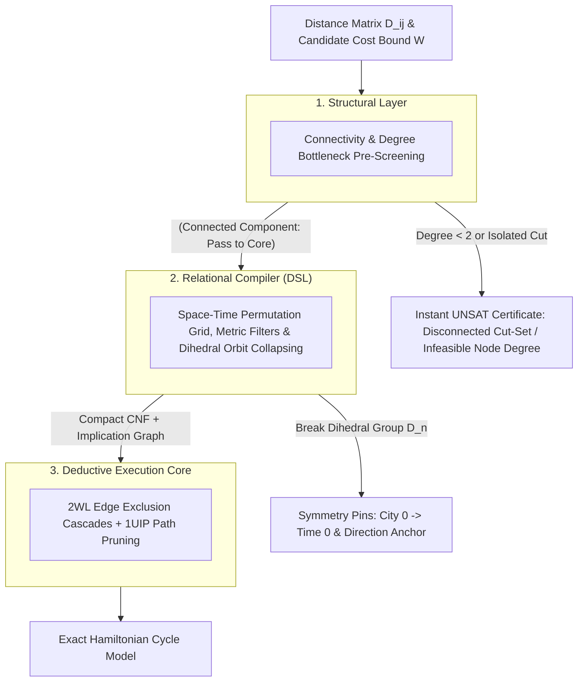

#  Designing a Structural Reasoning Engine: Systems Architecture Guide for the Traveling Salesperson Problem (TSP)

|  |  |  |
| :---         |     :---:      |          ---: |
|  |  |  |
|  |  |  |
|  |  |  |
|  |  |  |
