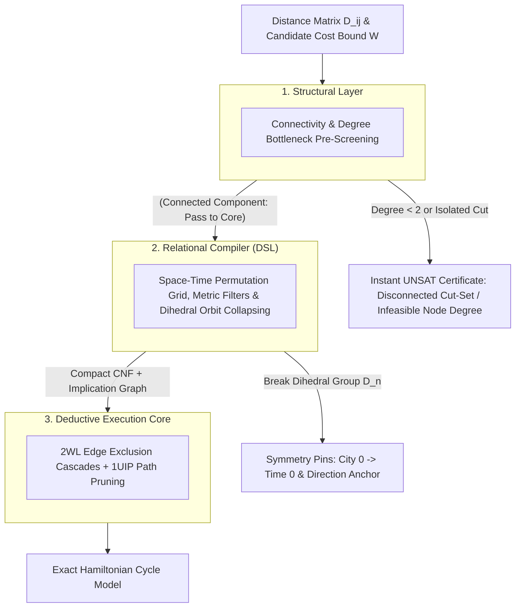

#  Designing a Structural Reasoning Engine: Systems Architecture Guide for the Traveling Salesperson Problem (TSP)



##    1. Core Engineering Philosophy: Permutation Encoding with Metric Filtering
Classical approaches to the Traveling Salesperson Problem (TSP) rely on Integer Linear Programming (ILP) with lazy cutting-plane generation (such as Danzig-Fulkerson-Johnson sub-tour elimination constraints) or Branch-and-Bound over continuous LP relaxations. When instances exhibit dense graphs or intricate combinatorial structures, linear relaxations often weaken, forcing solvers into heavy branch-and-cut exploration.

The Reasoning Engine reformulates TSP as an Exact Space-Time Permutation System with Metric Boundary Exclusion:
*    The Discrete Space-Time Grid: Rather than calculating arithmetic sums inside logic clauses, the tour is represented as an $n \times n$ Boolean coordinate matrix mapping each city to a discrete visit sequence step.
*    Metric Cut Projections: A candidate tour cost or bottleneck limit $W$ is mapped into direct pairwise exclusion clauses. Any edge $(u, v)$ where $\text{dist}(u, v) > W$ is forbidden from occurring consecutively in time:

$$\neg (\text{City}_u \text{ at } t \land \text{City}_v \text{ at } t + 1) \equiv (\neg X_{u, t} \lor \neg X_{v, (t+1) \bmod n})$$
*    Dihedral Automorphism Breaking: A Hamiltonian cycle on $n$ vertices has an automorphism group of order $2n$ ($n$ cyclic shifts and 2 path traversal directions). We eliminate these identical search trees before search begins.

##    2. The 3-Tier Layer Cake Architecture

###    Layer 1: Structural Analysis (Topological & Graph Pre-Screening)

Before generating CNF variables, the structural layer analyzes the connectivity and degree properties of the subgraph formed by edges with weight $\le W$:
*    The Invariant: Every vertex in a valid Hamiltonian cycle must have an undirected degree $\ge 2$. Furthermore, the filtered subgraph must form a single connected component containing all $n$ nodes.
*    Execution: A quick $O(V + E)$ graph traversal (e.g., Breadth-First Search) verifies connectivity and node degrees. If any node has degree $< 2$ or the graph is disconnected, the engine returns an immediate UNSAT certificate without compiling any clauses.

###    Layer 2: Relational Compiler (Structural DSL)

When the filtered topology passes the structural check:
*    Coordinate Mapping: Maps each discrete tuple $(\text{city}, \text{step})$ to a unique positive integer literal ID $X_{c, t}$.
*    Structural Invariants: Enforces that each time slot holds exactly one city (add_exactly_one), and each city is visited at exactly one step (add_exactly_one).
*    Symmetry Breaking: Eliminates the Dihedral group $D_n$ by anchoring City 0 at Time 0 (cyclic shifts) and requiring the city at Step 1 to have a smaller index than the city at Step $n - 1$ (reversal).
*    Metric Filter Generation: Emits binary exclusion clauses for all edges exceeding threshold $W$.

###    Layer 3: Deductive Execution Core (CDCL / 2WL)

The compiled representation is solved by the deductive engine:
*    Two-Watched Literals (2WL): Propagates edge exclusions in $O(1)$ amortized memory operations. Making a choice for Step $t$ immediately eliminates all incompatible destinations for Step $t + 1$.
*    1UIP Conflict Resolution: If a partial tour dead-ends into a closed sub-loop, conflict-driven clause learning extracts the minimal conflict cut and backjumps non-chronologically.

##    3. Concrete Implementation: TSP Systems Architecture

###    Step 1: Coordinate Space Definition

For $n$ cities and $n$ sequential visit steps, the state space is modeled as an $n \times n$ allocation matrix:
*    Let Boolean variable c_{i}_t_{j} denote: "City $i$ is visited at step $j$."
*    Total boolean variables registered: $n^2$.
```python
from ReasoningKit import StructuralDSL

dsl = StructuralDSL()

# Discrete Coordinate Registration
# Maps 2D state space (city_idx, time_step) directly to bit indices
def get_tour_var(dsl, city_idx, time_step):
    return dsl.get_var(f"c_{city_idx}_t_{time_step}")
```
###    Step 2: Structural Integrity Rules

Every valid Hamiltonian path must satisfy two fundamental permutation invariants:
1.    Space Uniqueness: Exactly one city occupies step $t$.
2.    Time Uniqueness: Each city is visited at exactly one step $t$.

```python
def apply_tour_integrity_rules(dsl, n):
    # Rule 1: Every time slot t has exactly one city
    for t in range(n):
        slot = [get_tour_var(dsl, c, t) for c in range(n)]
        dsl.add_exactly_one(slot)

    # Rule 2: Every city c is visited at exactly one time slot
    for c in range(n):
        timeline = [get_tour_var(dsl, c, t) for c in range(n)]
        dsl.add_exactly_one(timeline)
```
###    Step 3: Automorphism / Symmetry Breaking

Because a circular tour can start at any of the $n$ cities and be traversed clockwise or counter-clockwise, an unconstrained solver faces $2n$ identical representations of every candidate route.

We collapse these symmetries using structural pins:
1.    Cyclic Shift Anchor: Pin City 0 to Step 0 ($n$-fold reduction).
2.    Directional Reversal Anchor: Require that City at Step 1 has a smaller index than City at Step $n - 1$ (2-fold reduction).
```python
def apply_tsp_symmetry_breaking(dsl, n):
    # 1. Cyclic Shift Anchor: Fix City 0 at Step 0
    c0_t0 = get_tour_var(dsl, 0, 0)
    dsl.formula.append([c0_t0])

    # 2. Traversal Direction Anchor: Forbid c_a at step 1 if c_b at step n-1 (for all c_a > c_b)
    for ca in range(n):
        for cb in range(ca + 1, n):
            v_ca_step1 = get_tour_var(dsl, ca, 1)
            v_cb_last = get_tour_var(dsl, cb, n - 1)
            dsl.formula.append([-v_ca_step1, -v_cb_last])
```
###    Step 4: Metric Boundary FilteringTransitions exceeding the maximum allowed edge threshold $W$ are forbidden across all consecutive steps modulo $n$:
```python
def apply_metric_filter(dsl, n, dist_matrix, max_edge_threshold):
    for u in range(n):
        for v in range(n):
            if u == v:
                continue
            if dist_matrix[u][v] > max_edge_threshold:
                for t in range(n):
                    next_t = (t + 1) % n
                    var_u_t = get_tour_var(dsl, u, t)
                    var_v_next = get_tour_var(dsl, v, next_t)
                    # Binary exclusion: ~(u_t AND v_{t+1})
                    dsl.formula.append([-var_u_t, -var_v_next])
```
##    4. Execution Workflow
```python
import time
from collections import deque
from ReasoningKit import StructuralDSL, ReasoningCore

def check_topological_connectivity(n, dist_matrix, threshold):
    """Tier 1: Fast graph degree and component connectivity check."""
    adj = {i: [] for i in range(n)}
    for u in range(n):
        for v in range(n):
            if u != v and dist_matrix[u][v] <= threshold:
                adj[u].append(v)

    # Check minimum degree condition (must be >= 2 for cycle participation)
    for u in range(n):
        if len(adj[u]) < 2:
            return False

    # Check global reachability / single connected component
    visited = set()
    queue = deque([0])
    visited.add(0)

    while queue:
        curr = queue.popleft()
        for neighbor in adj[curr]:
            if neighbor not in visited:
                visited.add(neighbor)
                queue.append(neighbor)

    return len(visited) == n

def solve_bounded_tsp(n, dist_matrix, threshold, enable_semantic_bypass=True):
    # Tier 1: Structural Pre-Screening
    if enable_semantic_bypass and not check_topological_connectivity(n, dist_matrix, threshold):
        return None

    # Tier 2: Relational Compiler (DSL)
    dsl = StructuralDSL()
    apply_tour_integrity_rules(dsl, n)
    apply_tsp_symmetry_breaking(dsl, n)
    apply_metric_filter(dsl, n, dist_matrix, threshold)

    # Tier 3: Deductive Execution Core
    solver = ReasoningCore(dsl.formula, dsl.var_count)
    assignment = solver.solve()

    if assignment is None:
        return None

    # Decode sequence of cities
    tour = [-1] * n
    for t in range(n):
        for c in range(n):
            vid = get_tour_var(dsl, c, t)
            if assignment.get(vid, False):
                tour[t] = c
                break
    return tour

def optimize_tsp(n, dist_matrix):
    print(f"--- [TSP] Starting Systems Optimizer ({n} Cities) ---")

    # Extract distinct non-zero edge weights
    weights = sorted({dist_matrix[i][j] for i in range(n) for j in range(n) if i != j})

    low = 0
    high = len(weights) - 1
    optimal_tour = None
    best_bottleneck = -1

    start_time = time.perf_counter()

    # Binary search over candidate edge thresholds
    while low <= high:
        mid = low + (high - low) // 2
        threshold = weights[mid]
        print(f"  Testing Bound <= {threshold:2d} ... ", end="", flush=True)

        tour = solve_bounded_tsp(n, dist_matrix, threshold, enable_semantic_bypass=True)

        if tour is not None:
            print("[FEASIBLE]")
            optimal_tour = tour
            best_bottleneck = threshold
            high = mid - 1
        else:
            print("[INFEASIBLE]")
            low = mid + 1

    duration = time.perf_counter() - start_time
    print("\n--- Optimization Complete ---")

    if optimal_tour is None:
        print("No valid Hamiltonian tour exists.")
        return

    total_cost = sum(
        dist_matrix[optimal_tour[t]][optimal_tour[(t + 1) % n]]
        for t in range(n)
    )
    route_str = " -> ".join(str(c) for c in optimal_tour) + f" -> {optimal_tour[0]}"
    print(f"Optimal Minimax Route: {route_str}")
    print(f"Bottleneck Edge Cost: {best_bottleneck}")
    print(f"Total Tour Cost:      {total_cost}")
    print(f"Wall Time Duration:   {duration:.4f}s")


if __name__ == "__main__":
    # 6-City Distance Matrix Benchmark
    matrix = [
        [0,  10, 15, 20, 25, 30],
        [10,  0, 35, 25, 18, 22],
        [15, 35,  0, 30, 28, 12],
        [20, 25, 30,  0, 14, 16],
        [25, 18, 28, 14,  0, 24],
        [30, 22, 12, 16, 24,  0]
    ]

    optimize_tsp(6, matrix)
```
##    5. Architectural Comparison: Classical Search vs. Reasoning Engine

| Feature | Branch-and-Bound / ILP Solvers | Reasoning Engine Pipeline |
| :---         |     :---:      |          ---: |
| Search Space | Continuous LP relaxation with dynamically added cutting planes | Discrete Space-Time Grid: Exact permutation constraints compiled into CNF |
| Symmetry Management | Evaluates reversed or shifted tours unless branch-and-cut callbacks are defined | Dihedral Orbit Pruning: Origin and direction pins eliminate all $2n$ equivalent cycles in the compiler |
| Edge Pruning | Arithmetic sum bounding across the entire graph | Metric Bottleneck Clauses: Incompatible transitions are eliminated in $O(1)$ amortized time by 2WL |
| Dead-End Resolution | Chronological backtracking to earlier relaxation nodes | 1UIP Learning: Isolates sub-path contradictions and immediately learns an asserting cut clause |
