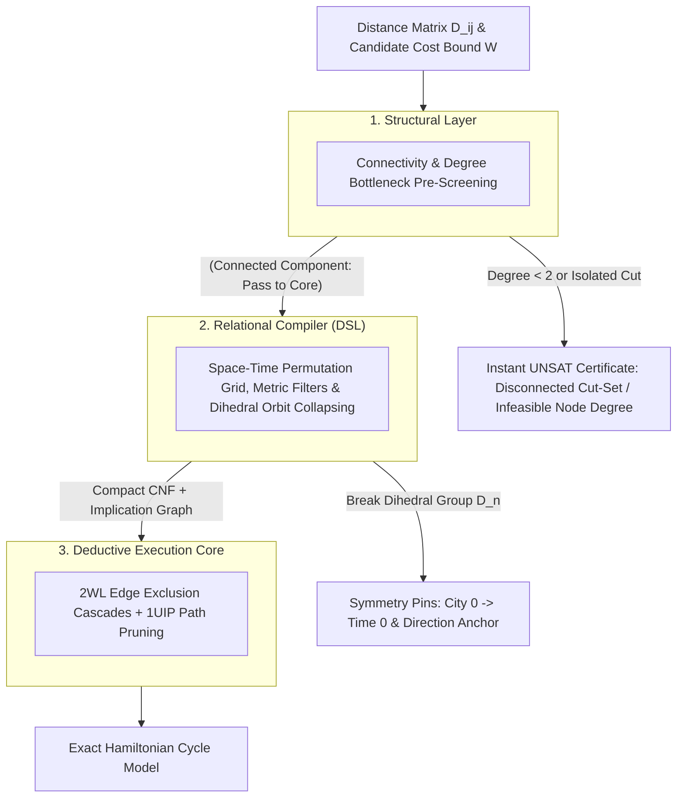

#  Designing a Structural Reasoning Engine: Systems Architecture Guide for the Traveling Salesperson Problem (TSP)

##    1. Core Engineering Philosophy: Permutation Encoding with Metric Filtering
Classical approaches to the Traveling Salesperson Problem (TSP) rely on Integer Linear Programming (ILP) with lazy cutting-plane generation (such as Danzig-Fulkerson-Johnson sub-tour elimination constraints) or Branch-and-Bound over continuous LP relaxations. When instances exhibit dense graphs or intricate combinatorial structures, linear relaxations often weaken, forcing solvers into heavy branch-and-cut exploration.

The Reasoning Engine reformulates TSP as an Exact Space-Time Permutation System with Metric Boundary Exclusion:
*    The Discrete Space-Time Grid: Rather than calculating arithmetic sums inside logic clauses, the tour is represented as an $n \times n$ Boolean coordinate matrix mapping each city to a discrete visit sequence step.
*    Metric Cut Projections: A candidate tour cost or bottleneck limit $W$ is mapped into direct pairwise exclusion clauses. Any edge $(u, v)$ where $\text{dist}(u, v) > W$ is forbidden from occurring consecutively in time:

$$\neg (\text{City}_u \text{ at } t \land \text{City}_v \text{ at } t + 1) \equiv (\neg X_{u, t} \lor \neg X_{v, (t+1) \bmod n})$$
*    Dihedral Automorphism Breaking: A Hamiltonian cycle on $n$ vertices has an automorphism group of order $2n$ ($n$ cyclic shifts and 2 path traversal directions). We eliminate these identical search trees before search begins.

|  |  |  |
| :---         |     :---:      |          ---: |
|  |  |  |
|  |  |  |
|  |  |  |
|  |  |  |
